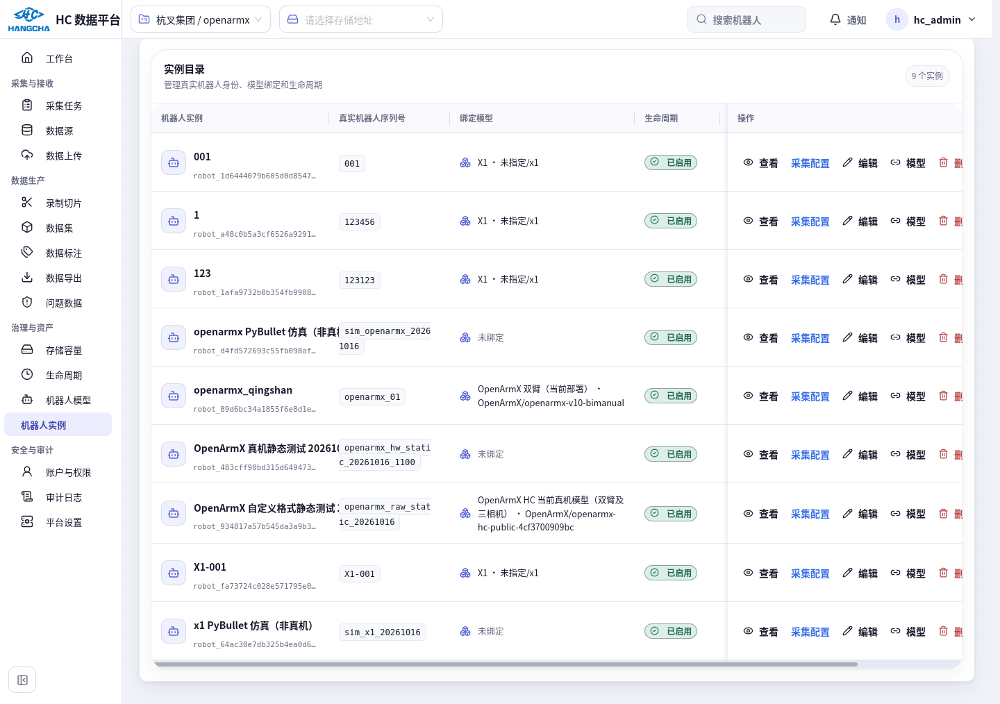
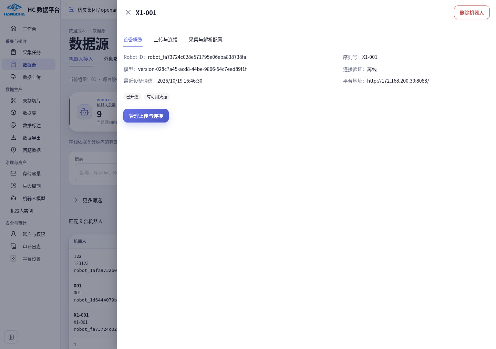
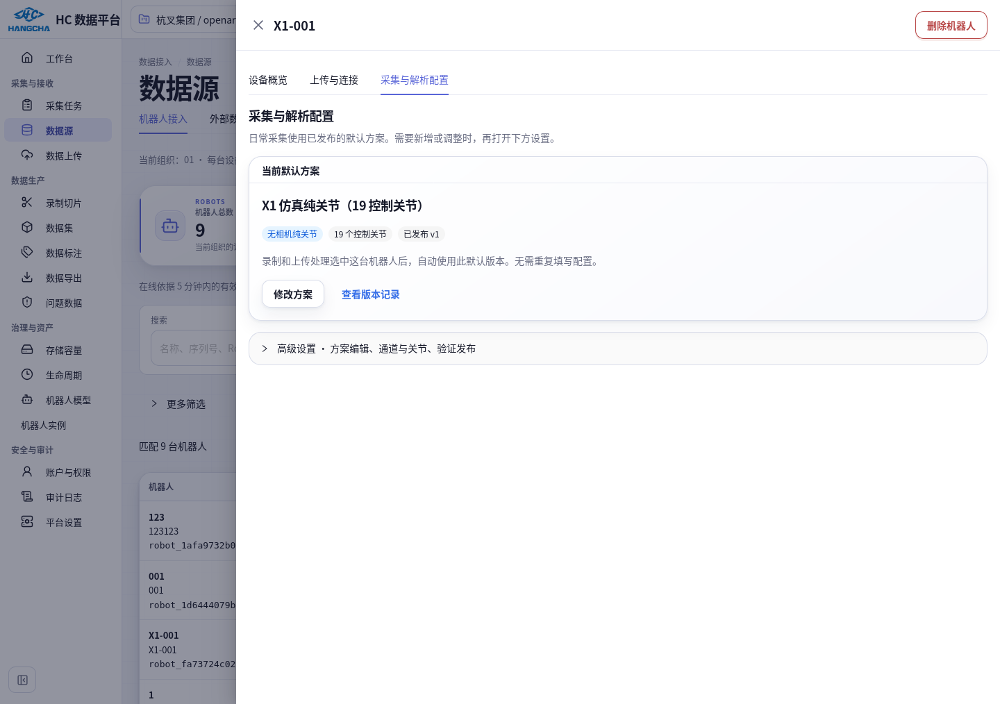
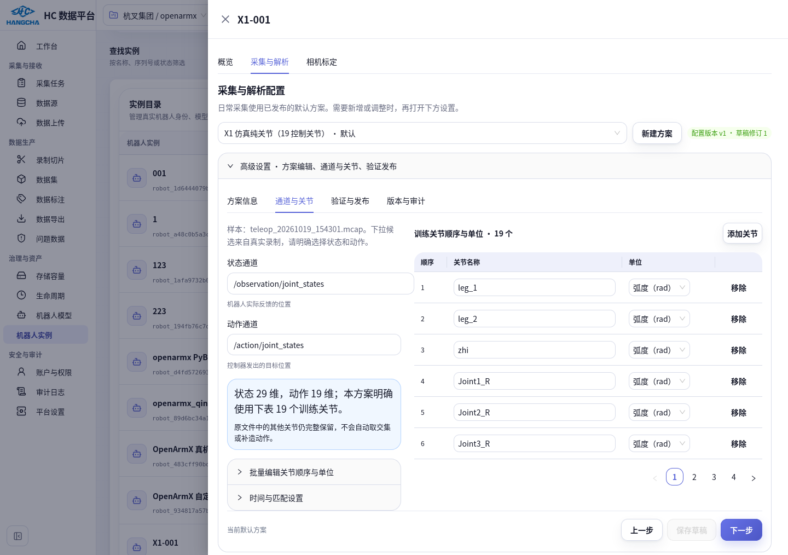
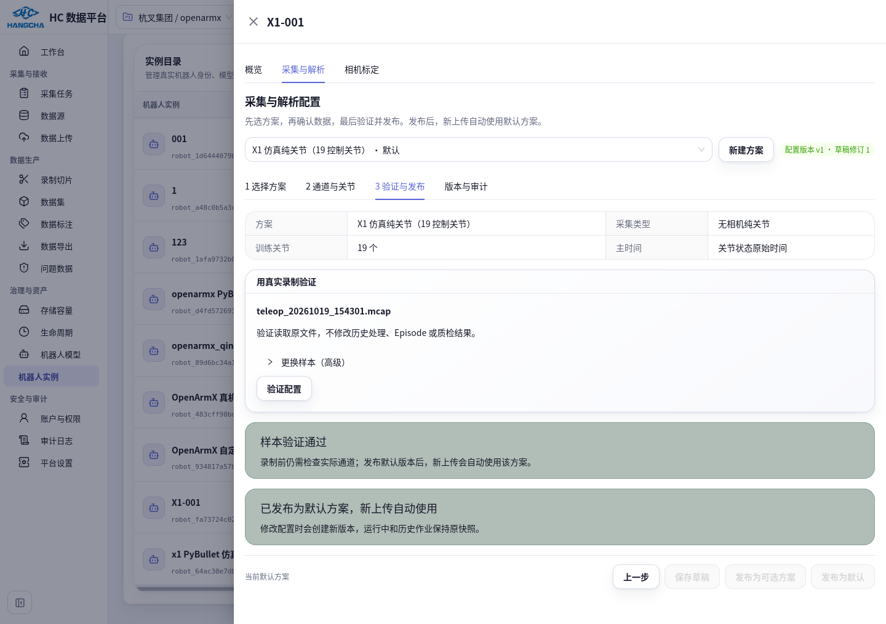
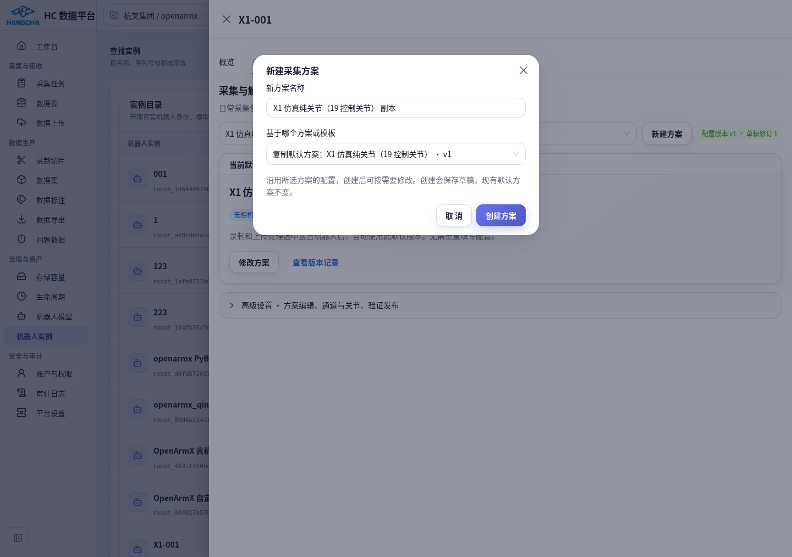
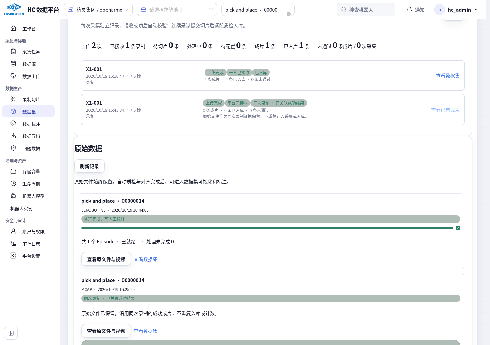

# X1 / 014 处理结果与纯关节页面操作

更新：2026-10-20。本文记录用户明确要求处理 014、确认 19 个控制关节，以及要求简化配置页面后的实际操作。平台当前运行目录 `/home/hc_op/workspace/hc_DataPlatform` 已更新；不是仅存在于隔离分支的设计稿。

## 从哪里进入

数据源页入口：**数据源 → 机器人接入 → 查看接入详情 / 继续配置**。详情默认打开 **设备概览**，其他导航为 **上传与连接 / 采集与解析配置**；首次进入不显示新建方案或通道表单。

- 左侧 **治理与资产 → 机器人实例**，搜索 `X1-001`，点击该行 **采集配置**。
- [直接打开 X1-001 配置](http://192.168.2.23:8088/settings/robot-instances?robot=robot_fa73724c028e571795e06eba838738fa&section=processing&scheme=x1-sim-joints-19)。若仍显示旧布局，刷新当前平台页面（Ctrl+Shift+R）。
- 实例详情按 **概览 / 采集与解析 / 相机标定** 分页。首次进入只显示默认方案摘要。下方 **高级设置** 默认收起，展开后按 **方案信息 / 通道与关节 / 验证与发布 / 版本与审计** 导航。
- 关节页左侧是通道、时间与批量设置，右侧是每页 6 个关节的可编辑表。切换步骤或关节页会保留当前输入。桌面浏览器实测关节分页和底部按钮都在可视区内。





## X1 现在已经配置好

默认方案 **X1 仿真纯关节（19 控制关节）**，方案标识 `x1-sim-joints-19`，发布 **v1**。用户无需再次填写或重复发布。

| 页面内容 | 已保存值 |
| --- | --- |
| 采集类型 | 无相机纯关节 |
| 采集软件 | HC-teleop-robotic / X1 PyBullet simulation |
| 状态通道 | `/observation/joint_states` |
| 动作通道 | `/action/joint_states` |
| 训练关节 | 用户确认的 19 个控制关节；顺序在表中可见 |
| 单位 | 19 个关节均为 `rad` |
| 时间来源 | 关节状态 MCAP 原始 log time |
| 图像 / 深度 / 派生动作 | 不声明相机、不伪造视频；派生动作关闭 |
| 验证样本 | `teleop_20261019_154301.mcap`，实际解析验证 PASSED |

单位和映射来自原 MCAP、同次导出 `meta/teleop_sync.json` 的单位与动作顺序声明，以及实际仿真发布代码和关节类型核对。没有从型号名称或 URDF 单独猜测 topic、单位、数据角色。状态通道 29 维、动作通道 19 维，用户明确选择其中 19 个控制关节；头部 2 个、轮子 8 个没有被补造动作。原始 MCAP 所有维度保留。




## 再创建一个纯关节方案

1. 进入 **采集与解析配置**，展开下方 **高级设置**，再点 **新建方案**，弹出创建窗口。默认复制当前方案的已发布版本；也可以明确选择匹配模板或空白方案。
2. 填写 **新方案名称**，点 **创建方案**。这一步会真正保存草稿，并显示创建成功；刷新后方案仍在，旧默认方案不变。
3. 使用现有 X1 默认方案作为基础时，纯关节模式、19 个控制关节、通道和单位都会带入，无需重复填写。要调整再点 **修改方案**，进入下方高级设置；修改后点 **保存草稿**。
4. 点 **验证与发布 → 验证配置**，使用原录制样本验证。显示 **样本验证通过** 后点 **发布为默认**；只供手动选用的方案可点 **发布为可选方案**。



修改已发布方案时需重新保存、验证，发布生成新版本。已发布版本、运行中作业与历史快照不变。新型号没有匹配模板时保留待填写内容；没有真实样本不能发布，先存档一个 MCAP，再从该记录的“前往机器人配置”带入样本。不需要为 X1 当前 v1 再走一遍这些步骤。

## 删除机器人实例

在 **机器人接入** 列表目标行或详情右上角点 **删除机器人 → 确认删除机器人**；在 **机器人实例** 目录也可删除。未使用的机器人会从数据库和列表移除，同时清理未发布配置草稿、上传身份（含已删除身份残留）、凭证、项目分配和型号绑定；保留操作审计。删除后刷新不会重新出现。

如果存在原始数据、上传记录、已发布配置、数据源、拓扑或标定记录，会显示具体引用数量。已有历史或已发布版本的实例应停用或退役；可解除的关联先在对应页面解除。**X1 的 014 成功结果和不可变配置仍受保护，不能为删除实例一并擦除。**前一轮仅删除隔离测试机器人。用户随后明确指出 223 仍未删除，本轮已通过真实页面删除 **223（序列号 23）**，确认数据库无实例、两个目录刷新不再出现。上传身份按钮已明确标为 **移除上传身份**，不会被当成整机删除。详见[223 删除和接入详情修复记录](robot-223-deletion-and-navigation-20261020.md)。

## 以后如何上传和处理

纯关节是机器人采集方案，不是新的文件扩展名；文件仍为 MCAP。

### 从机器人端上传

上传归属绑定 X1-001 与采集任务。新客户端开始录制时固定配置引用；旧客户端未发送引用时，平台根据兼容规则在首次接收时保存实际默认配置快照。已有作业不会被新的默认方案改变。平台配置不会启动相机或改变运动控制。

### 从网页手动上传 MCAP

1. 进入 **数据上传 → 新建上传**。
2. 选采集文件夹，或展开 **选择 MCAP、ROS bag 或带清单的数据包**，选择 MCAP 文件。
3. 网页直接上传 MCAP 当前采用“先保存原始文件”的流程：确认窗口先选择目标数据集，再确认上传。该窗口不提供机器人/方案选择；这是实际浏览器验证的界面。
4. 上传后，在 **上传记录 → 原始数据** 找到这批文件，点 **准备录制 / 重试**。选择采集任务和 **X1-001**；平台使用该机器人的默认发布配置准备录制，并保存本次快照。如果该数据集尚未配置标注规则，按窗口提示先配置规则。
5. 准备成功后进入 **预览与切片**，查看关节曲线，按时间选片段并提交；后台质检和入库，随后从数据集导出。图像质检显示“不适用”，不会生成占位视频。

失败记录可查看本批次实际快照、历史版本及原始通道；修改默认方案不会自动重试旧包。确实需要重试的普通失败记录，在“重试处理”中明确选择新版本。**014 已经做了同源关联，不应再次点击重试生成第二份数据。**

## 014 实际处理结果

原 MCAP 没有图像消息，原因是仿真录制；配置无法恢复未录入的图像。此次保留已有成功 LeRobot 成片，并将 MCAP 作为同次录制的原始证据关联到它。

| 项目 | 结果 |
| --- | --- |
| 任务 | `00000014 / pick and place` |
| 原 MCAP 上传 | `riu-445ff5ed97e8529db900a3af16cd0ff5` |
| 原 MCAP Raw | `raw-4909658c01345e0ab025fb0c0ec6d433` |
| 保留成功 Episode | `rie-54102ae0b172579eafa375a28550c2b1` |
| 成功结果 | READY / PASS / 114 帧 / dataset_version 1 |
| 成功结果更新时间 | 仍为 `2026-10-19 08:44:05.263076+00:00` |
| 014 采集统计 | 上传 2 次、接收 1 条录制、成功成片 1 条、失败采集 0 次 |
| 014 任务质检统计 | 通过 1、待评估 0、时长 7.585906 秒 |
| 原处理记录 | 两次失败的配置快照、错误与原文件均保留；未重处理 |

新 19 关节方案用于之后按此方案处理的数据。已有 29 维状态 / 19 维动作的 LeRobot 结果保持原样，没有被重算成新的 19 维结果，也没有增加第二个 Episode。

页面显示 **同次录制 · 已关联成功结果**，点击 **查看已有成片** 打开 014 数据集。历史错误折叠在 **查看历史处理错误与当时配置** 中，相关重复重试入口隐藏或禁用。



## 本阶段验证与数据操作清单

- 真实平台 Firefox：列表入口、已填方案、内外导航、关节分页、验证样本与默认 v1、审计、上传同源结果、数据集及返回确切原记录，通过。
- 隔离数据库 Firefox：新建方案、保存草稿、实际样本验证、发布 v1、修改后再验证发布 v2、v1 文档不变、重载恢复，通过。没有为了 UI 测试新建业务配置版本或重复上传 014。
- 本阶段后端 24 项测试通过；前端累计 20 个不同用例通过（包括最终新增的 7 个配置/同源展示用例）。类型、ESLint、架构检查通过。完整 A–G / 18 项验收及前阶段全链路、权限、并发、迁移与格式兼容证据见[主实施记录](robot-instance-processing-config-implementation.md)。
- 业务库已执行新增结构迁移 024、025、026；status 为 165/165、无漂移、无缺失。执行前备份 `reports/robot-014-recovery-20261020/verified-before-deploy.pgdump`，已用 `pg_restore --list` 验证。
- 真实旧 profile：盘点 1 个候选、0 个跨作用域配置冲突；旧布局和单位为空，保留原值。**旧配置候选迁移执行 0 项。**
- 真实数据写入仅限用户明确要求的 014 同源关联（1 项），以及用户确认的 X1 模板、19 关节草稿、实际验证和默认发布 v1。
- 同源执行清单摘要 `6f1bc864ea4a80ce8461e9fe04071d3124957b7855edac53b933e493fcdc2b6d`；`candidate_ids=[]`，`source_link_ids=[2bc92210da4455ba16759b897bfe054f8cef1565bf60f316c9bb13f78627d71b]`。详见受控报告目录的 `014-inventory.json`、`014-approval.json`、`014-applied.json`。
- 未执行其他历史配置迁移、批量重试、Episode/QC 改写、原始文件删除或机器人运动/相机/ROS 改动。

## 部署、执行与回退

平台本阶段按每个文件 SHA256 核对并备份，再将工作树任务增量并入当前运行主目录；不覆盖其他终端的并发修改。后台结构迁移通过官方 migrator 顺序安装，API/worker 已重启，前端 Vite 加载当前文件。代码仍为未提交工作区修改，未擅自提交或合并 git 分支。机器人端实现和隔离验证仍在原实施工作树，本阶段没有安装到运行中的机器人端；新客户端部署和真实硬件联调仍是发布待办。旧客户端兼容路径保留。

结构状态检查：

```bash
python -m hc_data_platform.core.migrations status
```

历史候选盘点命令（只读；使用明确指定目标库的 `HC_POSTGRES_DSN`）：

```bash
python -m hc_data_platform.robot_processing.migration --output /review/inventory.json
```

需要重复执行已批准的 014 关联时，工具会重新核对清单摘要，已存在关系返回幂等结果；不能把本次批准扩大到其他候选。新增旧配置迁移或真实重处理仍须明确清单，不执行批量重试。

回退遵循主实施记录的 forward-only 规则：优先回退界面，保留兼容新旧合同的 API/worker 及 024–026 表。已发布配置不能原地修改或删除，应发布纠正版本。只有另行确认关联错误时才撤销对应的单条同源关系并记录审计，不能清空关系表。不要整库恢复覆盖其他终端在此后产生的业务成果；备份用于事故恢复核对。三次 UI 增量前文件副本与 SHA256 位于报告目录 `ui-before*` / `ui-delivery*.json`，回退前同样检查并发修改。

全局安全门禁仍有前阶段复现的 3 个既有失败；不能宣称整个仓库门禁全绿。真实机器人 ROS/相机/运动硬件、机器人端运行安装以及独立离线安装验证没有在本阶段完成。业务平台实际 014 的数据保护、同源统计与页面路径已单独验证通过。
