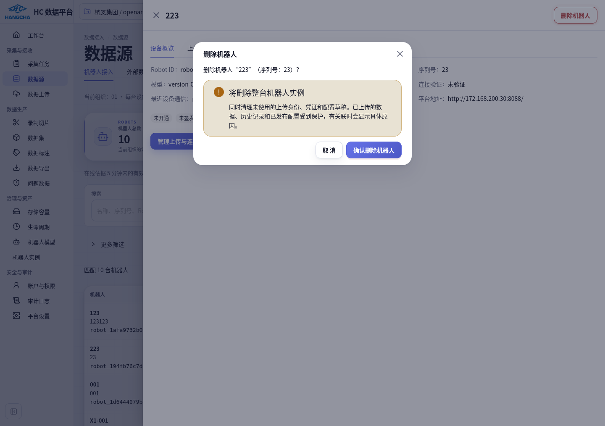
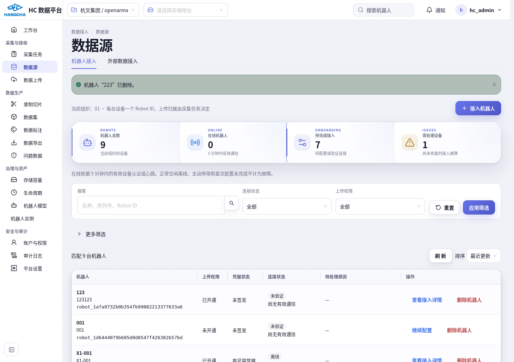

# 223 实际删除与接入详情修复

2026-10-20，针对用户反馈“223 点击删除后仍在”和“顶部仍有新建方案”，修复用户实际使用的 **数据源 → 机器人接入** 入口，并完成指定实例删除。

## 原因和修改

数据库显示 223 的上传身份在北京时间 10:59:32 被标为删除，但机器人实例没有删除审计、仍存在。该页面原按钮调用的是上传身份删除接口；上一轮遗漏了这个入口，不能以实例目录的测试替代它。

- 接入列表和详情右上角新增 **删除机器人**，调用组织级机器人实例删除接口。成功后刷新接入统计和实例目录，并关闭已删除的详情。
- 原按钮明确改名 **移除上传身份**，确认文案说明不会删除机器人实例。机器人删除仍检查历史数据和已发布版本，返回具体阻止项。
- 接入详情默认 **设备概览**，其他页签为 **上传与连接 / 采集与解析配置**。新建、选择方案与草稿修订信息移入配置页下方 **高级设置**，两个入口共享这一布局。
- 修正删除确认窗口层级，确保从详情抽屉点击删除后，确认按钮不会被抽屉覆盖。

主要文件：`frontend/src/pages/p02-data-sources/components/RobotOnboardingTab.tsx`、`RobotIdentityConsole.tsx`、`frontend/src/features/robots/ProcessingConfigEditor.tsx`、`frontend/src/features/robots/api/hooks.ts`、`frontend/src/pages/p15-robots/instances-page.tsx` 及相关测试。

## 已执行的真实操作

用户指定 **223** 后，先核对名称、序列号和稳定 ID，确认没有 Raw、上传、已发布配置、数据源、拓扑或标定引用，再通过真实浏览器 **删除机器人 → 确认删除机器人** 执行。

| 项目 | 结果 |
| --- | --- |
| 组织、机器人、序列号 | `01 / 223 / 23` |
| 稳定 ID | `robot_194fb76c7d4d5085a873ef8c39220f23` |
| 删除时间 | 2026-10-20 11:06:37（Asia/Shanghai） |
| 实例、上传身份、配置草稿、型号绑定剩余记录 | 均为 0 |
| 实例查询 | HTTP 404 |
| 接入目录匹配数 | 0 |
| 两个列表重新加载 | 均无 223 |
| 删除审计 | `robot.asset.deleted` 保留 |
| 其他机器人 / 014 成功 Episode | 保持不变 |

[实际删除与数据库核验结果](validation/robot-223-delete-and-navigation-20261020/live-deletion-result.json)

## 验证与边界

- 前端 25 项通过：接入详情分页、整机删除的对象与确认、拒绝删除的反馈、权限隐藏、身份移除文案，以及配置新建与版本复制回归。[测试报告](validation/robot-223-delete-and-navigation-20261020/223-navigation-frontend.xml)
- 真实 Firefox 隔离环境复现“身份已删除、实例仍在”，从新入口删除带草稿和身份残留的实例，确认数据库、API、两个目录与重新加载结果；检查历史实例受到保护。[浏览器记录](validation/robot-223-delete-and-navigation-20261020/browser-isolated.json)
- 当前主目录 TypeScript、54 项架构检查、修改文件 ESLint 通过。实际 LAN 浏览器验证了删除 223 与新布局。没有重新执行上一阶段的全套管线验收。
- 本轮没有新增后端或数据库迁移，没有发布配置或重处理数据。真实删除仅 223；014 的成功成果没有修改。

代码先在隔离工作树验证，按 SHA256 核对后将 8 个前端代码/测试文件同步到运行主目录，未覆盖其他终端修改。原文件、部署摘要、删除前信息和脚本位于 `/home/hc_op/workspace/reports/robot-223-delete-and-navigation-20261020`。

回退界面前先核对 `deployed-files.json`，只恢复本轮差异。不要整库恢复或恢复旧上传凭证；代码回退不会恢复已由用户指定删除的 223。操作审计保留，删除后的旧 Robot ID 不应重新启用。
