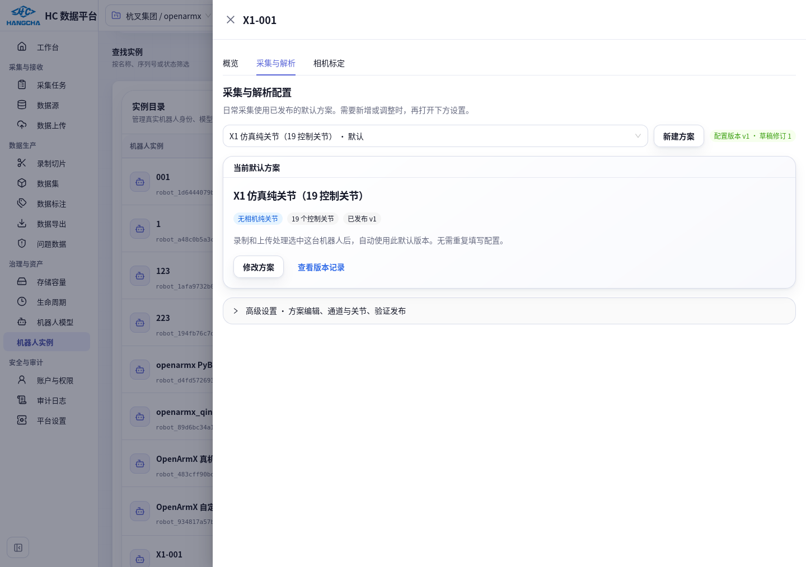
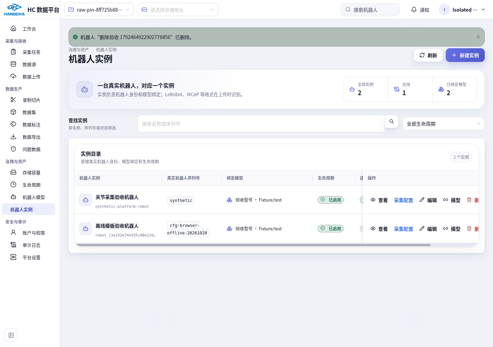
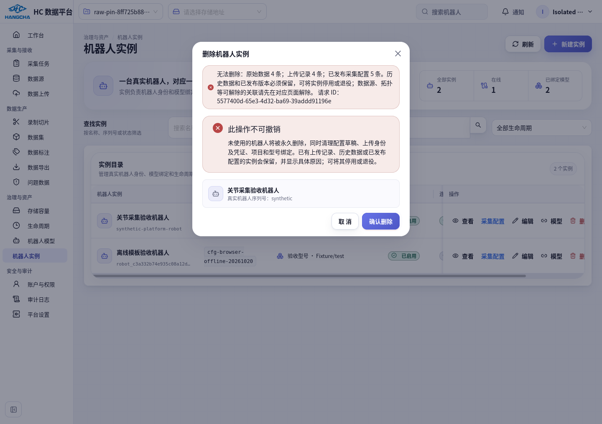

# 机器人配置操作修复记录（2026-10-20）

本轮处理用户提出的三项问题，代码已更新到当前运行主目录。入口为 **治理与资产 → 机器人实例 → 目标行“采集配置”**。

## 已完成

| 问题 | 修复后的行为 | 主要文件 |
| --- | --- | --- |
| 新建方案没有结果 | 弹窗填写名称、选择复制方案或模板，点击“创建方案”立即保存草稿并选中；刷新仍存在。复制已发布内容，保留旧默认与历史版本；失败保留表单并显示错误 | `frontend/src/features/robots/ProcessingConfigEditor.tsx` |
| 删除实例被残留引用阻止 | 未使用实例在事务中物理删除，同时清理草稿、已删除或仍启用的上传身份、无历史引用的凭证、连接票据/本地关联、项目分配和型号绑定；删除前保存草稿审计 | `backend/src/hc_data_platform/robot_assets/repository.py` |
| 删除错误含糊、页面状态未清理 | 显示实际阻断项和数量；成功后提示已删除、刷新目录、清理详情 URL；发布与删除共用机器人锁 | `backend/src/hc_data_platform/robot_assets/service.py`、`frontend/src/pages/p15-robots/instances-page.tsx` |
| 技术配置占据首屏 | 首屏显示默认方案摘要。高级设置默认收起；展开时摘要让出空间，内部使用标签导航和关节分页 | `ProcessingConfigEditor.tsx`、`ProcessingConfigEditor.module.css` |

## 页面操作和截图

现有 X1-001 已有 **X1 仿真纯关节（19 控制关节）v1**，日常无需重新填写。

新增：**新建方案 → 填新方案名称 → 选择来源 → 创建方案**。复制 X1 默认方案会带入已确认的纯关节配置。创建只保存草稿；按需修改后保存，再 **验证与发布 → 验证配置 → 发布为默认/可选方案**。

高级修改：**修改方案 / 高级设置 → 方案信息、通道与关节、验证与发布、版本与审计**。状态通道、动作通道、单位及时间来源不自动猜测。

删除：实例列表目标行 **删除 → 确认删除**。没有历史引用的实例真正从数据库删除。保留的审计不是可用机器人，旧凭证不再能访问。

物理删除仍保留必要边界：原始数据、上传记录和已发布配置不可连带清除。数据源、拓扑组件、标定记录也会列出具体数量。历史实例可以停用/退役，可解除的关联先在对应页面解除。此次没有用户指定的真实待删实例，因此没有代删业务实例。

## 验证结果

| 验证 | 结果及证据 |
| --- | --- |
| PostgreSQL 集成、权限、并发、历史保护、现有配置回归 | **26/26 通过，无跳过**；[JUnit](validation/robot-config-usability-fixes-20261020/usability-backend.xml) |
| 前端新建持久化、失败保留输入、默认版本复制、只读权限、配置导航 | **7/7 通过**；[JUnit](validation/robot-config-usability-fixes-20261020/usability-frontend.xml) |
| 当前主目录类型检查、Vite 生产构建 | **通过**；仅既有大包体积提示 |
| 架构、修改文件 ESLint/Ruff | **54 项架构检查通过；ESLint/Ruff 通过** |
| 真实 Firefox 隔离环境 | **通过**：创建草稿、刷新恢复、实际 MCAP 验证、发布 v1、旧默认/历史不变；删除带草稿和身份/凭证残留的实例后 API 404、数据库 0 行、刷新仍不出现；历史实例删除返回具体阻断项。[浏览器记录](validation/robot-config-usability-fixes-20261020/browser-isolated.json) |
| 用户实际 LAN 页面 | **通过**：X1 列表入口、摘要首屏、创建弹窗和取消、高级配置导航、返回目录；未改业务配置。[浏览器记录](validation/robot-config-usability-fixes-20261020/browser-live.json) |
| 014 成果保护 | **通过**：2 次上传、1 条接收录制、1 个 READY/PASS Episode、失败 0；114 帧、dataset_version 1、原更新时间和旧处理快照不变。[只读核验](validation/robot-config-usability-fixes-20261020/after-verification.json) |

新增重点用例为 `backend/tests/robotics/test_configured_robot_deletion.py`、`test_robot_deletion_history.py`，并扩展目录 API 和配置编辑器测试。全部测试写入只发生在隔离 `hc_config` 数据库。正式 LAN 的创建弹窗只打开、取消，没有提交。

原方案 18 项全链路验收与更早的已知门禁限制见[主实施记录](robot-instance-processing-config-implementation.md)。本轮不宣称重新执行了全部端到端管线或整个仓库测试。

## 数据库、交付和回退

本轮新增结构迁移 **0 项**、业务机器人删除 **0 项**、业务配置发布 **0 项**、历史重处理 **0 项**；继续使用已安装的 024–026 结构和不可变历史约束。不运行历史迁移或批量重试。

运行目录为 `/home/hc_op/workspace/hc_DataPlatform`。实现先在隔离工作树验证，再按文件 SHA256 核对后同步 9 个代码/测试文件；保留其他终端改动，未执行 git reset、清理、提交或合并。前端及 API 使用现有开发服务加载此次文件。

本轮原文件备份、部署摘要、浏览器脚本和完整证据在 `/home/hc_op/workspace/reports/robot-config-usability-fixes-20261020`。若需回退，先核对 `deployed-files.json` 与当前文件，逐文件恢复 `before/` 内本轮版本；存在之后修改时只反向应用本轮差异，不能覆盖其他终端工作。新增测试文件按本轮清单处理，不恢复整库，也不删除配置发布历史或审计。删除功能本身为永久删除，回退代码不会重新创建已由用户确认删除的实例。

正式版本提交/部署和机器人端运行安装、真实硬件联调仍按主实施记录推进；此轮没有改变机器人运动控制、ROS 发布或相机驱动。
