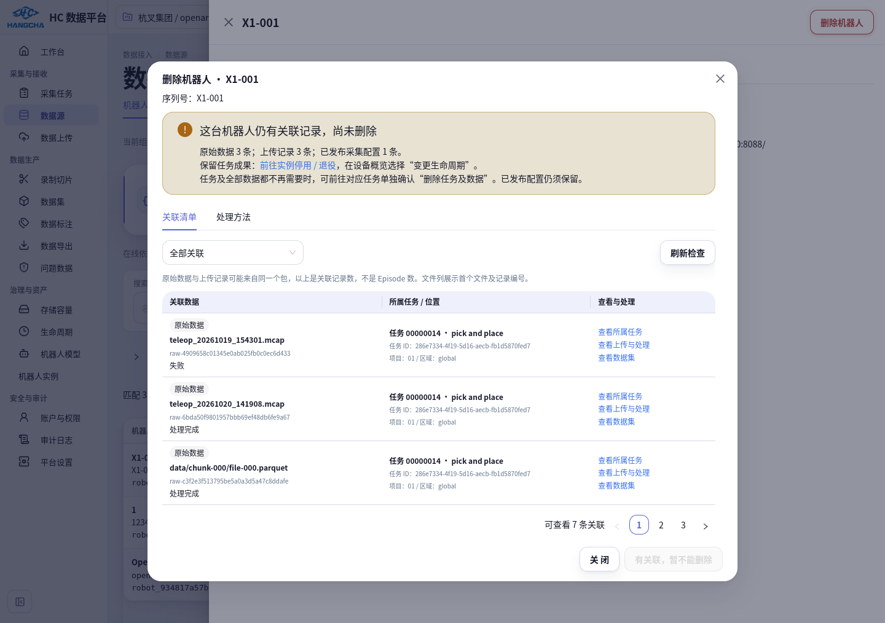
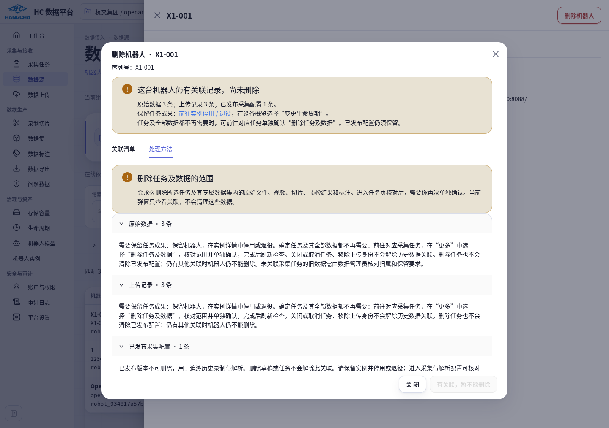
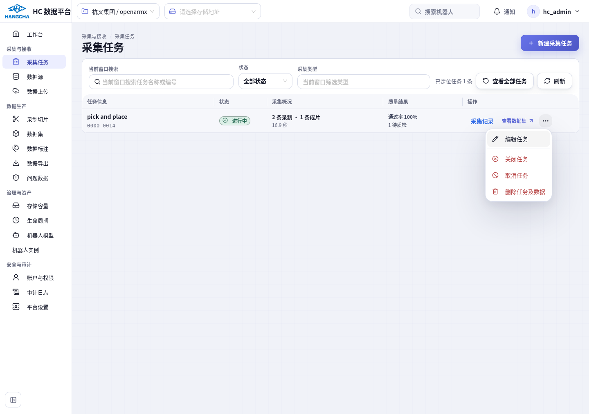
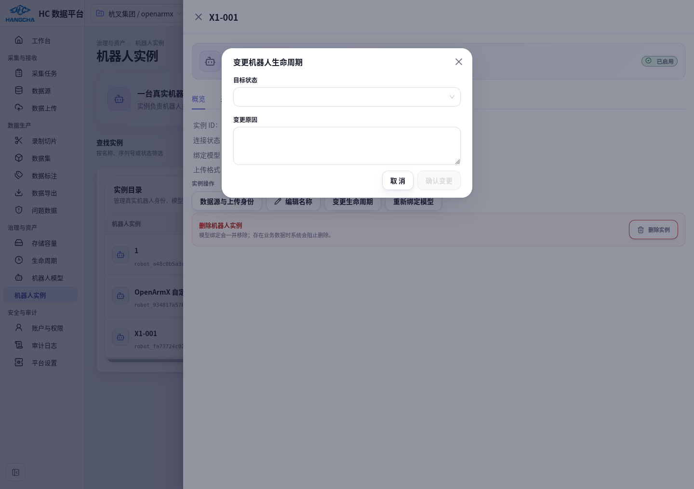

# 机器人删除关联清单与处理入口

2026-10-20。针对“机器人因为有数据删不掉，但不知道关联哪些数据、属于哪个任务、怎么处理”的反馈，在当前运行页面增加删除前检查。**本轮没有删除、停用或退役任何业务机器人，没有删除任务或重处理历史数据。**

## 页面怎么使用

1. 刷新页面，进入 **数据源 → 机器人接入 → 选择机器人 → 右上角「删除机器人」**。
2. 在 **关联清单** 中查看文件、状态、任务编号和名称、项目与区域。可按关联类型筛选、分页或刷新检查。
3. 点击行内 **查看所属任务 / 查看上传与处理 / 查看数据集 / 查看方案版本**，进入对应对象。浏览器返回可回到原机器人详情，重新打开删除检查。
4. 切换 **处理方法**，查看每种阻断原因的处理步骤。没有关联时才允许确认删除。

另一个入口 **机器人实例 → 选择机器人 → 概览 → 删除实例** 使用同一清单和删除逻辑。

## 该选哪种处理方法

| 情况 | 页面给出的处理方法 |
| --- | --- |
| 需要保留采集成果，只是不再使用机器人 | 点击 **前往实例停用 / 退役**，在实例概览点 **变更生命周期**，选择目标状态并填写原因。历史文件、任务、版本和成果保留。 |
| 某个任务及其全部成果都确定不需要 | 点击 **查看所属任务**，核对任务后打开操作列的 **更多操作（…）→ 删除任务及数据**，在任务页面单独确认范围。这个操作会删除该任务及其专属数据集中的原始文件、视频、切片、质检结果和标注。 |
| 存在已发布采集配置 | 发布版本不可删除。删除草稿或任务也不会解除这一关联，应保留实例并停用或退役。 |
| 存在拓扑组件、标定记录 | 清单显示实际组件或标定编号；核对依赖。没有提供解绑或历史删除入口的类型，明确说明需保留并停用或退役。 |
| 存在机器人数据源绑定 | 前往对应数据源核对，不再使用时在该页单独删除；仅停用数据源不会解除绑定。 |
| 记录属于无查看权限的项目或区域 | 只显示受限记录数量，不泄露文件、任务名称和编号；请相应管理员核对。可查看但不在当前项目/区域的行会提示先切换作用域。 |

关闭或取消任务、移除上传身份，都不会解除历史数据关联。删除关联任务后也不保证机器人可删除：已发布配置等其他关联仍会阻止物理删除。清单中的原始数据数和上传记录数可能指向同一个包，**不能相加当作录制或 Episode 数量**。

## 这次实际检查到的 X1

当前页面验证时间为 2026-10-20 下午；测试入口为当时机器地址 `http://172.168.200.30:8088`。地址随网络变化，日常使用现有平台地址即可。

- 机器人：X1-001，`robot_fa73724c028e571795e06eba838738fa`。
- 关联任务：**00000014 / pick and place**，任务 ID `286e7334-4f19-5d16-aecb-fb1d5870fed7`。
- 关联记录：**3 条原始数据、3 条上传记录、1 个已发布配置版本**。文件包含 `teleop_20261019_154301.mcap`、`teleop_20261020_141908.mcap`，以及 LeRobot 包的首个资产 `data/chunk-000/file-000.parquet`。文件列展示首个资产和稳定记录编号，不把首个资产冒充完整包清单。
- 方案：`x1-sim-joints-19`，**X1 仿真纯关节（19 控制关节）v1**。
- 旧 MCAP 保持同源证据关联，仍可展开历史错误与当时配置；没有图像的事实不变。
- 受保护 Episode `rie-54102ae0b172579eafa375a28550c2b1` 仍为 **READY / PASS / 114 帧**，原更新时间不变。验证前后对机器人、发布版本、任务、3 条 Raw、3 条上传、该 Episode、2 条旧处理快照、1 条同源关系逐行比对，完全一致。

前阶段“2 次上传”的结论是当时快照。本轮开始前业务环境已有 10 月 20 日的新 MCAP，所以这里使用实时盘点的 3 条上传；没有用旧统计覆盖新事实。

[只读关联报告](validation/robot-deletion-details-20261020/live-report.json) · [数据保护核验](validation/robot-deletion-details-20261020/verification-summary.json)

## 主要实现

| 文件 | 修改 |
| --- | --- |
| `backend/src/hc_data_platform/robot_assets/deletion.py` | 统一删除阻断定义，分页返回实际 Raw、上传、配置版本、拓扑组件、标定、数据源关联及任务归属；提供处理说明。 |
| `robot_assets/repository.py`、`service.py`、`router.py` | 新增只读删除预检；复用相同阻断定义进行最终删除检查。查询使用一致性只读快照，最终删除仍在原有锁与事务中检查，不能靠旧预检绕过并发保护。 |
| `frontend/src/features/robots/RobotDeletionDialog.tsx`、`.module.css`、`api/deletion.ts` | 两页共用删除弹窗；关联清单与处理方法分页，每页 3 条，错误时禁止确认；支持类型筛选、刷新与具体对象跳转。 |
| `pages/p02-data-sources/components/RobotOnboardingTab.tsx`、`pages/p15-robots/instances-page.tsx` | 接入目录和实例目录使用同一预检；修复实例详情中生命周期、名称、模型弹窗被抽屉遮挡的问题。 |
| `pages/p20-collection-tasks/page.tsx`、`query-codec.ts` | 支持 `taskId` 精确定位，从详情接口读取任务，不依赖当前列表分页窗口；支持“查看全部任务”。 |
| OpenAPI、生成的前端类型和相关测试 | 加入新接口及契约；保留其他终端已存在的接口和改动。 |

新接口：`GET /api/v1/organizations/{organization_id}/robots/{robot_id}/deletion-check`，支持 `kind`、`offset` 和 `limit`（1–100）。要求组织内 `robot.manage`；具体数据还按项目、区域及数据读取能力过滤。使用 `Cache-Control: private, no-store`，不返回存储凭据、原始 JSON 快照或无权限任务详情。

## 验证结果与证据

| 验证 | 结果与范围 |
| --- | --- |
| 后端与数据库集成 | **20 项通过**，真实隔离 PostgreSQL/MinIO。覆盖任务/文件识别、分页过滤、匿名/无权限/跨组织/项目/区域、发布版本保护、空实例删除、删除与发布并发锁、幂等及历史不变。[报告](validation/robot-deletion-details-20261020/backend-final.xml) |
| 前端专项 | **50 项通过**，覆盖删除弹窗、接入页面、身份管理、配置编辑和任务精确定位，包括窗口外任务及只读账户。[报告](validation/robot-deletion-details-20261020/frontend-final.xml) |
| 静态与契约 | TypeScript、受影响文件 ESLint、后端 Ruff、54 项架构检查及 API 生成一致性检查通过。 |
| 前端生产构建 | **通过**。最终运行主目录 `vite build` 成功；输出到一次性容器的临时目录，不替换业务静态资源。 |
| 真实 Firefox，隔离环境 | **通过**。两个删除入口、任务定位、返回路径及阻断展示；仅新建并删除一个 synthetic 空机器人，历史测试记录不变。[记录](validation/robot-deletion-details-20261020/browser-isolated.json) |
| 真实 Firefox，当前业务页面 | **通过**。实际点击 X1 关联清单、处理方法、任务 014 及更多菜单、生命周期弹窗、旧 MCAP 历史记录、数据集及配置方案；没有点击任务删除确认或保存生命周期。[记录](validation/robot-deletion-details-20261020/browser-live.json) |
| 业务数据保护 | **通过**。验证前后指定业务行完全一致；原成功 Episode/QC、历史处理快照、同源关系保留。 |
| 全仓公共 API 安全门禁 | **3 项失败、3 项通过**；部署前主目录基线复现相同 3 项失败：旧 annotation 文件路由先返回 503、原矩阵缺少已有路由、既有 gap 列表断言失败。新增接口鉴权专项通过，但不能声称全仓安全门禁通过。[当前](validation/robot-deletion-details-20261020/security-current.xml) / [基线](validation/robot-deletion-details-20261020/security-baseline.xml) |

本轮是删除提示与处理路径的增量验证，没有重新执行最初 18 项全链路验收。原配置、迁移、纯关节管线的验收和硬件未验证边界继续以[主实施记录](robot-instance-processing-config-implementation.md)为准。

真实浏览器发现生命周期弹窗层级错误后修复，再次实际打开并取消通过。旧 MCAP 因已有成功同源结果，文件和错误信息位于“查看历史处理错误与当时配置”折叠区；已展开核对，未执行重试。

## 数据库、执行边界和回退

- **本轮数据库结构迁移：0 项；历史配置迁移：0 项；历史重处理：0 项；业务数据删除：0 项。** 没有修改既有迁移 checksum、Episode 或质检结果。
- 更新运行主目录前按 SHA256 核对文件，先在隔离工作树完成实现。21 个代码、测试和契约文件的最终摘要在 `reports/robot-deletion-details-20261020/deployed-files.json`；其他终端修改未覆盖、回退或清理。
- 原文件快照在同目录 `before/`，`baseline.json` 记录改前摘要。代码回退先逐项核对当前文件和部署摘要；一致时才恢复本轮涉及文件，出现后续改动则人工合并本轮反向差异。新增文件按本轮清单移出，不使用整仓 `git reset` 或 `git clean`。
- OpenAPI 聚合与前端生成文件需按回退后的所有当前片段重新生成，不能用旧文件覆盖其他终端后来加入的接口。前后端同时恢复匹配版本。
- 无需数据库回退。回退界面不会删除或恢复任何业务成果；既有发布版本和审计必须继续保留。
- 当前开发运行页面已更新。正式提交、评审与部署仍按团队流程执行。全仓安全门禁的既有问题需在对应工作中处理；任何真实任务清理、历史迁移或重处理仍需明确对象和范围。

完整脚本、前后只读快照、测试原始报告和 17 张页面截图保存在 `/home/hc_op/workspace/reports/robot-deletion-details-20261020`。文档附件只附清单和核验摘要，不复制完整业务数据库快照或临时登录材料。
