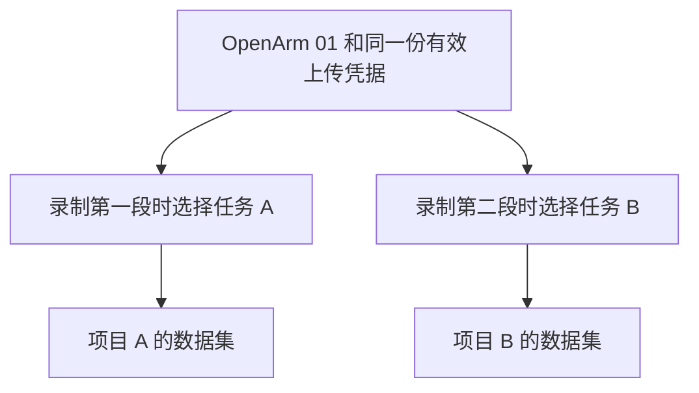

# HC DataPlatform 机器人接入流程调整方案与实施记录

**状态：A～F 本地实现完成，相关回归与浏览器验证通过；全仓已有失败及真机验证限制见下文。G～J 待审核。更新日期：2026 年 10 月 20 日。适用范围：数据源页面、机器人连接平台、选任务录制及自动上传。**


## 本轮 A～F 实现记录（2026-10-19）

本轮按用户指定范围实施 A～F：平台中的机器人接入、组织汇总、筛选、成功上传量及旧导入兼容。下文后来补充的 G～J（连接链接、机器人端任务列表、录制与自动上传）仍为待审核内容，不属于本轮已交付功能；当前接入使用身份系统签发的上传凭据。

| 范围 | 当前实现 |
| --- | --- |
| A 页面与样式 | 数据源下分为机器人接入、外部数据接入；沿用原有 P02 卡片、筛选栏、表格和详情组件。机器人按组织的权威实例聚合，外部连接器保留项目/Region 范围。 |
| B 统一接入 | 选择/创建实例、绑定已发布模型、上传规则、签发凭据、设备连接验证。原实例、身份、有效凭据复用；停用身份不会自动开启。创建意图保存在会话草稿，接口与凭据请求回执支持部分失败和响应丢失后的重试。 |
| C 归属与授权 | 组织管理权限仍需服务端检查；上传继续从 collection_task_id 解析组织、项目、数据集、Region。人工导入按操作员项目权限检查。 |
| D 兼容 | LeRobot 和 MCAP 改用组织机器人实例；实例须 ACTIVE，保留项目指派撤销和目标项目/Region 中旧机器人数据源的停用限制。同一范围旧配置冲突时按停用处理。历史记录、凭据摘要、ID 和项目关联保留；可见关联在详情中展示。旧详情/API 保留兼容，主流程不再手工创建机器人连接器。 |
| E 指标 | 四张卡片按组织完整设备集统计，独立于列表。成功上传量从去重的 Raw 提交记录聚合，按 committed_at 和 IANA 时区，默认 Asia/Shanghai；上传记录页与机器人详情使用同一接口。旧 verified_bytes_today 兼容字段返回实际 UTC 当日提交字节或 null。 |
| F 筛选 | 名称/序列号/Robot ID、连接状态、上传权限；更多筛选含凭据可用性。先筛完整结果再分页；URL 保存条件，切换标签不混用；卡片清除业务条件后应用快捷筛选，保留排序和页大小。 |

### 已落实的状态与重试规则

- 在线：服务端收到机器人有效凭据认证或心跳后 **300 秒以内**；达到 300 秒为离线。新配置无通信为未验证，旧身份观测不足或未来时间异常为未知；查询失败为暂不可用。
- 心跳：`POST /api/v1/robot-ingest/heartbeat`，使用机器人 Bearer 凭据；请求 `{"activity":"IDLE"}`，活动状态也可为 `COLLECTING`、`UPLOADING`。建议采集端每 60 秒发送一次。签发凭据、查看后台和凭据库解密均不更新设备在线状态。
- 活动故障：只有设备明确报告活动，且在 900 秒活动窗口内出现 300 秒通信超时，才记录需处理问题；已发生的故障不因时间流逝自动恢复。有效设备通信或设备报告空闲后恢复。正常空闲离线、主动停用/维护/退役、首次配置未完成不列为故障。
- 至少一份 ACTIVE、未过期凭据即为有可用凭据，与身份启用状态独立。旧凭据撤销后的可归属认证失败会记录原因，新凭据认证成功后恢复；猜测/无效摘要不会污染设备故障状态。
- 凭据操作持有身份行锁，并保存不含 Token 的请求回执。已复用/已签发的请求，之后即使凭据撤销再重放，也不会重新签发。2026-10-20 增加加密保存和管理权限下的“查看凭据”：签发响应丢失可从列表再次查看原凭据，绝不静默轮换或恢复已停用身份。旧版仅存摘要的凭据在下一次成功设备认证后补存密文。

### 2026-10-20 上传凭据操作补充

已实现新凭据关闭后再次查看、复制；撤销/过期凭据确认删除，列表移除且清除密文。
保留历史上传、原凭据 ID 和请求回执；删除重试、签发重试不会恢复凭据。列表取消只显示
最近 4 条的限制，改为可滚动列表。沿用原有详情、链接按钮和确认弹窗样式。

后端通过真实加密存储和权限接口实现，并已加入 `ingest/023_robot_credential_vault.sql`；
当前本地开发库和空白隔离库均已应用。使用原 `HC_DATA_SOURCE_CREDENTIAL_KEY` 派生加密
密钥，不更换配置。旧摘要不可逆；设备使用原凭据成功连接后可再次查看，补存前有明确提示。

本次验证与适用限制见 [凭据查看与删除验证](validation/robot-credential-vault-20261020.md)。

### 迁移与启动

新增 `backend/migrations/ingest/021_robot_onboarding.sql`，保留原 ID、凭据摘要、停用状态与历史数据，新增凭据请求回执与提交量索引，并撤回历史凭据库存储检查写入的无依据 ONLINE 状态。**2026-10-19 已在空白隔离库和当前本地开发库应用；未推送、未部署到远端环境。**

```bash
# 已有环境先使用原数据库连接配置执行迁移，勿更换现有凭据签名/加密配置。
cd backend
uv run python -m hc_data_platform.core.migrations upgrade
uv run python -m hc_data_platform.core.migrations status
uv run python -m hc_data_platform.core.openapi --runtime --output openapi.generated.yaml
cd ../frontend
pnpm gen:api
```

新服务仍需原有 PostgreSQL、对象存储、认证与项目权限配置。使用受限数据库应用角色的环境，需按已有数据库授权流程授予新 `ingest.robot_credential_requests` 表的 SELECT/INSERT 权限，组织 RLS 保持启用。既有机器人 Token 保持有效；增加周期心跳后，设备空闲时也可被持续观察。

### 验证状态

- 后端相关回归：**190 通过、12 跳过**。涵盖真实 PostgreSQL 并发、幂等、跨组织拒绝、同组织跨项目上传、旧导入约束、时区/跨日/提交去重及 MCAP 适用回归。另 6 个依赖 G0 固定目录和专用基础设施的处理集成用例因缺少 `/g0/fixtures/robot-ingest-manifest.json` 未通过，未列入此通过数字。
- 前端相关回归 **100 通过**；类型检查、生产构建、架构检查 54 项、客户端生成检查 15 项及 runtime OpenAPI/生成客户端一致性检查通过。前端全量 1193 项中 1192 通过，P21 导出异步用例一次未等到按钮；该文件单独复跑 13 项全通过，不将原全量运行写为全绿。
- 真实 Firefox 浏览器通过：新建设备、响应丢失后的重试、凭据一次签发、重复提交、有效心跳上线、停用保持与可用凭据组合筛选、刷新恢复、卡片联动、标签隔离、跨页搜索、空状态、503 错误及恢复、外部连接器表单、上传量时区显示、桌面与窄屏布局。测试新设备仅写入隔离数据库；当前本地环境也验证了页面与真实统计读取。
- 修复了页面“机器人接入暂不可用”的实际原因：新增接口未同步到前端 runtime 操作白名单；同时修正分页查询参数的 HTTP 整数解析。没有通过默认成功、固定统计或放宽权限掩盖错误。
- 当前本地库只读迁移校验：1 条旧机器人数据源；悬空机器人关联、缺失项目关联、重复有效身份、旧配置状态冲突、已提交 Raw 缺失提交时间均为 **0**。旧 ID、身份、凭据和历史记录保留。
- 全仓后端为 **2103 通过、15 失败、422 跳过、2 xfailed**；15 个失败均在修改前 HEAD 副本复现。全仓 Ruff/格式/mypy 也有已有问题；本轮涉及文件的样式检查通过，mypy 对比基线无新增诊断。没有改写无关模块来掩盖这些失败。
- 未验证：真实机器人端整链路、实际 OSS/边缘代理服务、专用 G0/G1/OpenArm 环境下的完整 LeRobot/MCAP 处理。机器人端连接链接、任务选择和录制自动上传属于后续 G～J，未实现。仅本地修改与验证，未推送或远端部署。

详细命令、结果与浏览器截图见 [A～F 本地验证记录](validation/robot-onboarding-20261019.md)。

---


平台入口统一为 **数据源页面 → 机器人接入标签页**。新设备从这里的“接入机器人”完成登记；已有设备打开“接入详情”，复制一个连接链接。机器人端只需粘贴链接并点击“连接”，平台地址、机器人身份和上传凭据由系统处理。

日常采集流程为 **平台创建任务 → 机器人选择任务 → 开始录制 → 停止后自动上传**。任务在开始录制时固定，换任务无需重新连接平台，之前的数据继续按原任务上传。

本文件作为主审核文档，包含页面布局、完整使用流程、已有设备迁移和产品选择；[机器人连接与选任务录制细节](robot-task-recording-proposal.md)补充交互、接口及异常处理。后续机器人端代码统一在 `HC-teleop-robotic` 的 `main` 分支实现，本轮连接与选任务方案审核通过后再编写相关代码。

## 先看一台 OpenArm 如何使用

以下设备名称和任务均为示例。

假设你有一台“OpenArm 01”，今天为项目 A 采集数据，明天为项目 B 采集数据。两个项目属于同一个组织。

第一次使用时：

1. 在“数据源 → 机器人接入”点击 **接入机器人**。
2. 选择平台已有的 OpenArm 01；如果没有，填写名称、真实序列号并选择已发布的机器人模型。
3. 确认允许上传的格式，例如 MCAP 和连续采集包，完成开通后点击 **复制连接链接**。
4. 在机器人页面粘贴链接，点击 **连接**。系统自动完成身份校验和配置，显示平台名称、机器人名称与连接结果。
5. 在平台创建项目 A 下的采集任务；机器人自动获取任务列表，也可以点击“刷新”立即更新。
6. 在机器人录制页面按名称选择任务，点击 **开始录制**；停止后系统按这一任务自动整理并上传。

任务也可以提前创建。已有设备从“数据源 → 机器人接入 → 接入详情”直接复制链接；已经连接且凭据有效的机器人可直接选任务录制。

明天采集项目 B 的数据时，继续使用这台机器人和同一份有效凭据，选择项目 B 下的有效采集任务即可。服务端仍然检查组织、任务状态、上传格式等条件。

**用户完成的是一次设备接入，以后每次采集选择任务。无需再次创建机器人、上传身份或凭据。**

## 调整前页面为何容易混淆

原有接入流程涉及四种相关对象。它们各有作用，但页面把其中几个对象做成了并列的创建入口。

| 对象 | 实际作用 | 调整前的操作位置 |
| --- | --- | --- |
| 机器人实例 | 记录一台真实设备的序列号、名称和模型 | 机器人实例页，或新建数据源时同步创建 |
| 机器人数据源 | 保存某个项目和 Region 下的接入配置 | 数据源页的“新建数据源” |
| 机器人上传身份 | 保存该机器人在组织内的上传权限和策略 | 数据源页的“新建身份” |
| 上传凭据 | 让采集端证明自己是哪台机器人 | 身份创建后，另外签发 Token |

“新建数据源”可以创建机器人实例并绑定模型，但不会自动创建上传身份；“新建身份”会选择已有机器人，创建成功后再进入签发凭据步骤。因此，用户完成一次创建后，还需要理解和完成另一段流程。[数据源创建逻辑](../frontend/src/pages/p02-data-sources/page.tsx#L467) · [身份创建逻辑](../frontend/src/pages/p02-data-sources/components/RobotIdentityConsole.tsx#L701)

另外，数据源表单中的“访问 Token”使用连接器凭据存储，机器人上传身份签发的 Token 使用另一套凭据存储，两者不会自动同步。组织级身份和项目级数据源又显示在同一个页面中，进一步增加了判断成本。[数据源凭据处理](../backend/src/hc_data_platform/data_sources/service.py#L225) · [机器人凭据签发](../backend/src/hc_data_platform/robot_ingest/service.py#L225)

## 拟议页面长什么样

### 数据源页分为两个区域

保留“数据源”页面名称，在该页面内增加两个标签页。“机器人接入”在下文均指这个标签页：

| 标签页 | 展示内容 | 主按钮 |
| --- | --- | --- |
| 机器人接入 | 当前组织中的机器人及其上传接入状态 | 接入机器人 |
| 外部数据接入 | 当前项目和 Region 下的 OSS、边缘代理连接器 | 新建外部数据源 |

“机器人接入”按真实机器人展示，每台设备只有一行。原来独立的“机器人上传身份”面板收进该标签页中的接入详情；“复制连接链接”也放在接入详情中。新设备在“接入机器人”流程完成开通后可直接复制链接。

机器人列表布局示例：

| 机器人 | 上传权限 | 凭据状态 | 连接状态 | 主要操作 |
| --- | --- | --- | --- | --- |
| OpenArm 01 | 已开通 | 有效 | 在线 | 查看接入详情 |
| OpenArm 02 | 未开通 | 未签发 | 未验证 | 开通上传 |
| OpenArm 03 | 已停用 | 有效 | 离线 | 查看接入详情 |

三个状态分别表达三件事：“上传权限”表示平台是否允许设备认证上传；“凭据状态”表示是否有可用上传凭据；“连接状态”表示平台最近是否实际观察到设备通信。**生成连接链接或签发凭据，都不能直接把设备显示为在线。**

机器人页不再出现独立的“新建身份”按钮，也不再要求填写连接器的“访问 Token”。OSS 等外部连接器仍保留各自需要的连接凭据。

### 筛选栏如何保留

保留筛选功能，分别服务于“机器人接入”和“外部数据接入”。当前筛选参数作用于数据源列表，机器人上传身份面板只接收范围和权限参数，并不跟随这些列表筛选变化。新页面中，每个标签页的筛选只对应本标签页的一张列表。[当前筛选项](../frontend/src/pages/p02-data-sources/page.tsx#L824) · [当前身份面板参数](../frontend/src/pages/p02-data-sources/page.tsx#L955)

机器人页默认展示“搜索、连接状态、上传权限”，凭据状态放入“更多筛选”。排序放在列表右上方，每页条数放在底部分页栏。

| 当前筛选项 | 机器人接入页的调整 | 外部数据接入页的调整 |
| --- | --- | --- |
| 搜索 | 保留，支持机器人名称、序列号、Robot ID | 保留，支持数据源名称和 ID |
| 连接器 | 移除；此标签页全部是机器人 | 保留，选择 OSS 或边缘代理 |
| 启用状态 | 改为“上传权限”：全部、未开通、已开通、已停用 | 保留连接器的启用或停用状态 |
| 连通状态 | 改为“连接状态”：全部、在线、离线、未验证、未知 | 按连接器展示检查结果；OSS 展示访问检查，边缘代理展示其连接状态 |
| 凭据状态 | 放入更多筛选：全部、未签发、有可用凭据、无可用凭据 | 放入更多筛选，采用各连接器的凭据状态 |
| 排序 | 最近更新、名称、最近设备通信；默认最近更新 | 最近更新、名称、最近检查 |
| 每页 | 移到分页栏，保留 10、20、50 条 | 同样移到分页栏 |

“上传权限”与“连接状态”可以组合使用。例如，“已开通＋离线”用于找出允许上传但目前不在线的机器人。认证失败、配置错误等属于问题原因，在“需处理设备”的列表或详情中查看，不继续混入在线和离线的选项。

“未验证”表示尚未观察到首次有效设备通信；“未知”表示观测不足，当前无法判断。“有可用凭据”表示至少有一份未过期、未撤销的上传凭据；旧凭据已撤销但新凭据有效的设备仍属于有可用凭据。凭据可用性与上传权限分别判断。

顶部卡片作为快捷筛选入口：点击“在线机器人”“待完成接入”或“需处理设备”时，清空原搜索和其他业务筛选，再应用对应条件；排序和每页条数保留。点击“机器人总数”恢复全部机器人。已生效的条件始终显示在列表上方，可单独取消或一键清除，避免折叠筛选后不知道列表为何变少。

例如，本组织有 10 台机器人，其中 2 台需处理。点击“需处理设备”后，列表显示这 2 台，顶部“机器人总数”仍为 10。继续搜索 OpenArm 后，列表可以缩小到 1 台，并明确显示“需处理设备＋搜索 OpenArm”。

所有筛选作用于完整的可见结果集，再分页；修改搜索、筛选、排序或每页条数后回到第一页。刷新页面和从详情返回时保留本标签页的筛选，两个标签页不互相带入无关条件。机器人列表仍按组织查询，外部数据源列表仍按当前项目和 Region 查询。

### 顶部统计卡片如何调整

统计仍然有用，但要和页面的管理对象对应。机器人接入页关注设备是否配置好、能否连接和上传；上传记录页关注实际收到了多少数据。两个标签页使用各自的统计范围，不共用一组含义不同的数字。

| 当前卡片 | 当前代码实际统计什么 | 建议调整 |
| --- | --- | --- |
| 数据源总数 | 当前组织、项目、Region 及筛选条件下的数据源记录数，包含机器人、边缘代理和 OSS | 机器人页改为“机器人总数”，按 Robot ID 去重；外部数据页统计外部连接器 |
| 在线 | 连接状态字段为 ONLINE 的数据源记录数 | 机器人页保留为“在线机器人”，改用实际设备通信及其时效判断 |
| 今日验证数据量 | 顶部卡片对应的后端字段目前固定返回 0 | 移到上传记录页，改为“今日成功上传量”，接入真实提交记录后展示 |
| 异常 | 连接状态为 DEGRADED、OFFLINE、AUTH_FAILED 或 CONFIG_ERROR 的数据源记录数 | 改为“需处理设备”，展示具体原因和处理入口 |

这些现有总览数字来自分页前的筛选结果，并非只统计当前这一页，也不是整个组织的机器人数量。[当前汇总逻辑](../backend/src/hc_data_platform/data_sources/service.py#L147) · [当前四项指标计算](../backend/src/hc_data_platform/data_sources/service.py#L1204)

当前“在线”存在口径问题：连接测试检查凭据能否从凭据库读取，成功后会将连接状态写为 ONLINE。这个结果不能证明机器人正在联网，因此页面上的“最近心跳正常”说明与该检查不足以对应。改造后，凭据读取成功只证明凭据存储检查通过；在线状态必须有实际设备通信依据，并设置明确的超时阈值。[连接测试写入状态](../backend/src/hc_data_platform/data_sources/service.py#L471) · [凭据库检查](../backend/src/hc_data_platform/data_sources/repository.py#L709)

建议机器人接入页顶部展示四张卡片：

| 卡片名称 | 拟议口径 |
| --- | --- |
| 机器人总数 | 本组织内当前用户可见、未删除的机器人实例数量，每个 Robot ID 只算一次 |
| 在线机器人 | 在规定时效内有有效设备心跳或其他可靠设备通信记录的机器人数量 |
| 待完成接入 | 尚未完成首次接入配置或连接验证、且未被主动停用或退役的机器人数量 |
| 需处理设备 | 存在尚未解决的接入故障，需要管理员或操作员处理的机器人数量 |

总览按组织统计，不受下方列表搜索、筛选、排序和分页影响；点击状态卡片筛选对应设备，并显示当前筛选条件。列表单独展示筛选后的匹配数量。各卡片是不同维度，不相加作为总数。同一台设备同时有多个故障，在“需处理设备”中只计一台。

### 当前异常和拟议需处理设备的区别

当前“异常”是连接状态分类，只统计数据源条数。它不直接统计上传失败次数、数据校验失败数量或 QC 不合格数据。当前公式也不排除主动停用的数据源，所以正常关机或已停用设备仍可能计入；UNKNOWN 则不计入，刚创建但尚未配置好的数据源可能不会出现异常计数。

拟议“需处理设备”只统计有明确原因、尚未恢复的接入问题，例如：

- 已开通机器人上传，但所有可用上传凭据均已过期或撤销。
- 存在尚未解决的认证失败或配置错误，并能给出对应原因。
- 有证据表明机器人正在执行采集或上传，设备通信却超过规定时间中断。仅有一个 ACTIVE 采集任务，不足以证明机器人此刻应该在线。

主动停用、正常空闲离线和首次接入尚未完成，分别保留其正常状态；单纯缺少配置进入“待完成接入”。单次失败后已经恢复的问题留在历史记录中，不长期累计成当前异常。数据完整性检查失败、处理失败和 QC 不合格分别在上传记录或质检页面显示。

点击“需处理设备”后，应看到“设备、原因、发生时间、下一步操作”，例如“OpenArm 01 → 上传凭据已过期 → 更换凭据”。

外部数据接入页可使用“连接器总数、最近检查通过、待配置、需处理连接”。OSS 展示实际访问检查的结果与时间；凭据库读取成功不能作为 OSS 连通成功。

### 今日成功上传量的统计位置和口径

“今日成功上传量”放在上传记录页，按当前项目和 Region 统计；机器人详情可显示该机器人的对应明细。它表示当日已通过平台要求的完整性检查并成功提交的原始文件字节总量，单位为 GB 等容量单位，不表示 QC 合格数据量。

统计按成功提交时间和页面标明的时区划分自然日，按上传记录去重。昨天开始、今天提交的上传应计入今天；失败、未提交和重复重试不重复计入。

身份详情目前也有一个同名“今日验证数据量”，该值来自已提交上传的原始文件字节合计，但时间筛选使用上传会话创建时间。实施时应一起统一名称和时间口径。[详情卡片的时间筛选](../frontend/src/pages/p02-data-sources/components/RobotIdentityConsole.tsx#L281) · [已提交数据量计算](../backend/src/hc_data_platform/robot_ingest/repository.py#L634)

所有指标在数据未接入、观测不足或查询失败时显示“暂不可用”或“未知”。只有真实查询结果为零时才显示 0。

### 首次接入流程

| 步骤 | 用户看到和操作的内容 | 系统完成的事情 |
| --- | --- | --- |
| 选择设备 | 选择已有机器人；或填写名称、序列号和模型 | 复用现有实例，或创建实例并绑定模型 |
| 设置上传规则 | 确认允许格式；需要时调整文件大小等限制 | 在同一流程内关联上传身份和策略 |
| 复制连接链接 | 点击“复制连接链接” | 生成限定组织和机器人的一次性连接票据 |
| 在机器人连接 | 粘贴链接，点击“连接” | 自动读取平台入口和本地机器人配置，兑换票据、保存凭据并验证连接 |

机器人端的连接界面只需要一个输入框：

```text
连接平台

[ 粘贴从平台复制的连接链接                         ]  [ 连接 ]

在平台“数据源 → 机器人接入 → 接入详情”复制连接链接到这里。
```

链接携带平台入口和短期一次性票据，建议有效期为 10 分钟，成功兑换后失效。过期后重新生成；同一次连接请求因超时重试，不重复创建身份或凭据。长期上传凭据由机器人服务保存，操作员无需复制 Token、填写各类 ID 或设置凭据路径。

已有有效身份和凭据的设备，直接进入接入详情；浏览详情或生成链接不会自动更换凭据，也不会重置设备的实际连接状态，普通连接不自动撤销其他有效凭据。已有身份被停用时，不会因再次进入流程而自动恢复。

如果创建实例成功、后续步骤失败，页面保留已完成的部分，提供“继续配置”。重试沿用同一台机器人。

设备验证在选择采集任务之前即可完成。机器人成功连接后自动获取任务；任务在开始录制时选择，正常上传直接沿用本段任务。

### 机器人详情展示什么

详情中使用用户可以直接理解的名称：

| 内容区域 | 展示内容和操作 |
| --- | --- |
| 设备信息 | 名称、序列号、Robot ID、机器人模型 |
| 上传设置 | 开通或停用机器人上传；修改允许格式和上传限制 |
| 接入配置 | 复制连接链接、链接有效期、凭据状态；平台地址和 Robot ID 可在详情中查看 |
| 连接情况 | 最近认证、最近心跳、失败原因 |
| 上传记录 | 按有访问权限的项目和采集任务查看记录 |

“机器人实例”页面继续管理设备信息、模型和生命周期。两个页面使用同一个 Robot ID，修改名称后两处显示同一结果。

常规接入使用连接链接，机器人自动取得并保存长期凭据。已有通过 Token 配置的采集端继续可用；管理员需要处理凭据泄露或主动撤销旧凭据时，使用单独的“更换上传凭据”操作，并明确查看受影响范围。相关采集端通过新的连接链接更新凭据，普通复制链接和查看详情不会触发撤销。

## 设备接入和数据归属如何分开

设备和上传身份属于组织。采集任务属于具体项目，并决定数据集和 Region。拟议机器人接入列表标明“当前组织”，切换项目时不重复生成设备或身份；上传记录继续按项目权限控制可见范围。

下图中，任务 A 和任务 B 属于同一组织的不同项目：



接入配置中不保存一个永久的数据归属项目。开始录制时保存任务及归属摘要，每批上传沿用这段录制的任务 ID，平台根据任务解析并复核归属。现有直传协议已经由任务确定归属，本方案进一步把选择时点固定到录制开始。[机器人直传协议](../docs/robot-authenticated-ingest.md#L3)

组织级接入管理需要对应的组织范围授权；现有项目权限不会因为页面合并而自动扩大。

## 机器人选择任务后录制并上传

### 任务列表和录制操作

首版建议显示同组织内符合机器人上传条件的进行中任务。平台创建有效任务后，机器人刷新即可获取；打开录制页面时自动刷新，页面可见时每 30 秒更新一次。列表支持按任务名称或编号搜索、按项目筛选，同名任务通过项目和编号区分。

当前任务模型没有执行机器人指派字段。本稿不增加必填的指派步骤；如需只允许指定机器人执行，应一并增加任务指派配置，并在任务查询和上传接口执行同一权限规则。这一选择列入审核项 H。

```text
平台：采集平台     机器人：OpenArm 01     已连接

采集任务  [ 杯子抓取 / 桌面操作项目 / 任务编号   ▾ ]  [ 刷新 ]
任务说明：从桌面抓起杯子，放到指定区域。
停止后自动上传：开启

[ 开始录制 ]
```

首次明确选择任务，后续记住最近一次有效选择。点击开始时再次验证任务并保存本段归属；任务失效时明确提示，不自动切到另一任务。录制期间锁定本段任务，停止后可立即为下一段选择新任务。

### 自动上传和归属规则

新连接默认开启“停止后自动上传”；已有连接保留原开关。停止后系统后台完成整理、必要封存和上传入队，用户不需要填写录制 ID、产物 ID 或再次选择上传任务。关闭自动上传后，可以在录制列表点击“上传”，归属仍使用录制时的任务。

| 场景 | 处理方式 |
| --- | --- |
| 任务 A 的第一段尚在上传，开始录任务 B | 第一段继续归属 A，第二段归属 B |
| 上传重试、刷新页面或重启机器人 | 保留每段原有任务、机器人和平台归属 |
| 正在录制时断网 | 继续本地录制，完成后等待恢复上传 |
| 断网后开始新录制 | 首版可明确选择“仅本地录制”，恢复后在该条记录补选任务 |
| 历史录制没有任务 | 从录制列表选择任务后上传，不自动套用页面当前任务 |
| 任务关闭或数据集归属发生变化 | 新建上传时复核；不符合条件则保留数据并提示处理，不自动改投其他任务 |

页面分别展示上传进度、平台处理状态和质检结果。已上传不等于处理完成或质检合格。已创建上传的继续处理沿用服务端会话规则；任务和权限仍由平台校验。

## 已有配置和导入流程如何过渡

### 已有设备如何显示

| 现有情况 | 调整后的处理 |
| --- | --- |
| 只有机器人实例 | 显示“未开通上传”，可继续开通 |
| 有机器人数据源，没有上传身份 | 复用原机器人，提供“开通上传”；保留原数据源记录 |
| 有上传身份，没有数据源记录 | 展示已有身份、凭据和连接状态；保持现有机器人直传能力 |
| 数据源和上传身份都存在 | 按组织和 Robot ID 汇总为同一行；保持已有 ID 和有效凭据 |
| 同一机器人有多个项目数据源 | 接入列表展示一台设备，原项目关联保留供兼容和追溯 |

已有停用状态不会被自动开启。遇到相互矛盾的旧配置，详情中显示需要处理的具体配置，迁移时明确决定其去向。

机器人已有完整连接配置时，自动验证后恢复显示；原有效凭据、任务归属和上传队列继续保留。迁移不自动开启原本关闭的上传，也不重写已封存数据。旧配置中的默认任务可作为最近使用任务，经验证后展示。

### 兼容现有人工导入

当前机器人 Token 直传链路不要求预先存在机器人数据源记录，但部分 LeRobot 人工导入处理路径仍要求目标项目和 Region 下存在已启用的机器人数据源；MCAP 处理配置也存在相关检查。因此，页面合并需要同时处理这些依赖。[LeRobot 目标校验](../backend/src/hc_data_platform/lerobot_imports/configuration.py#L64) · [MCAP 配置校验](../backend/src/hc_data_platform/lerobot_imports/mcap_processing.py#L36)

建议分两步落地：

1. **统一接入与采集流程。** 提供组织范围的机器人接入读取与管理能力；以同一个 Robot ID 关联实例和身份；同时交付单链接连接、机器人任务列表、录制时选择任务和自动上传。旧数据源记录及需要它的兼容入口暂时保留。
2. **统一旧导入路径的设备校验。** 将旧路径对设备存在性、项目使用资格和停用状态的判断逐项迁移到明确的规则中，保留任务、数据集、Region 和权限校验。兼容验证通过后，机器人接入主流程才完全退出手工创建机器人数据源的操作。

“停用机器人上传”控制机器人凭据认证及后续上传授权。人工导入使用操作员权限，仍由其导入规则控制。已上传的历史数据保留。

## 审核时需要决定的事项

以下是本轮审核的产品选择，可以逐项批注。

| 编号 | 建议采用的决定 | 对使用方式的影响 |
| --- | --- | --- |
| A | 数据源页分为“机器人接入”和“外部数据接入” | 机器人和 OSS 等连接器使用各自清晰的流程 |
| B | 机器人只保留一个“接入机器人”入口，上传身份由系统关联 | 用户无需单独创建身份；已有设备可继续配置 |
| C | 机器人接入按组织管理，任务在每次开始录制时固定 | 切换项目无需重新登记设备，旧数据始终沿用原任务 |
| D | 保留旧配置并分阶段迁移导入校验 | 先统一使用流程，验证兼容后再退出旧机器人数据源入口 |
| E | 顶部改为机器人总数、在线机器人、待完成接入、需处理设备；成功上传量移到上传记录页 | 接入页关注设备可用性，数据量采用真实提交记录统计 |
| F | 保留按标签页区分的筛选；机器人页默认提供搜索、连接状态和上传权限，凭据状态收进更多筛选 | 常用查询直接可见，卡片可快捷筛选，组织总览保持稳定 |
| G | 机器人粘贴一次连接链接并点击“连接”，建议链接 10 分钟有效 | 操作员不用填写平台地址、机器人 ID、Token 或凭据路径 |
| H | 首版可选同组织内符合条件的进行中任务 | 平台建好任务后直接选择；如需指定机器人执行，补充任务指派和服务端约束 |
| I | 新连接默认停止后自动上传，已有连接保留原开关 | 可关闭自动上传；人工上传和重试仍沿用录制时的任务 |
| J | 断网时继续当前录制，新段可仅本地录制 | 恢复后，无归属的数据逐条补选任务；首版不以缓存任务代替新的授权校验 |

其中 G 至 J 与机器人端细节文档采用相同规则。审核通过后的机器人端开发在 `main` 分支进行。

## 如何判断改动完成

- 新设备能从“数据源 → 机器人接入”的同一流程完成实例登记、上传权限设置、复制连接链接和连接验证。
- 机器人端只有一个连接链接输入框；粘贴并连接后自动显示正确设备与任务列表，不要求手填地址、ID 或 Token。
- 链接过期、重复兑换及连接响应丢失都有明确结果，重试不重复生成身份或凭据，失败不覆盖原连接。
- 平台已有机器人可以直接复用；重复提交或中途失败后重试，不会重复创建实例或身份。
- 机器人列表每台设备只有一行，能分清上传权限、凭据有效性和实际连接状态。
- 机器人统计按组织和 Robot ID 计算；列表搜索、筛选、排序、分页及多条旧数据源记录不会改变或重复累计总览。
- 两个标签页分别提供适用的筛选；筛选查询覆盖完整结果集，列表展示匹配数量和已生效条件，修改条件后回到第一页。
- 点击统计卡片可得到对应设备列表；清除筛选、刷新和从详情返回的行为一致，凭据有效性与上传权限的组合查询结果正确。
- 凭据库检查通过不能使设备被计为在线；需处理设备可展开具体原因，正常停用、空闲离线和已恢复故障不会被当作当前接入故障累计。
- 今日成功上传量按成功提交时间和明确时区计算，重试不重复计数；数据不可用时不以 0 代替。
- 新设备仅生成连接链接时仍显示待验证；已有设备保留实际连接状态。验证和在线状态由实际设备认证或心跳决定。
- 同一台机器人可用同一份有效凭据向同组织下的两个有效采集任务上传，数据分别进入任务指定的项目和数据集。
- 平台创建有效任务后机器人刷新即可看到；已关闭、跨组织或不符合上传条件的任务不能用于新的平台任务录制。
- 连续录制任务 A 和 B 时，两段分别按自己的任务上传；停止后自动完成整理与入队，重试和重启不会串任务。
- 录制中断网可保留数据，恢复后按原归属续传；无归属历史数据通过列表补选任务，旧连接保留原自动上传开关。
- 机器人实例页与接入页共享设备信息；机器人区域只展示身份系统的上传凭据状态。
- 有效凭据、已停用配置、历史上传记录和原项目关联在迁移中得到保留或明确映射。
- 机器人直传、LeRobot 人工导入、MCAP 相关处理及 OSS 和边缘代理原有路径完成适用的回归验证后，才移除兼容入口。
