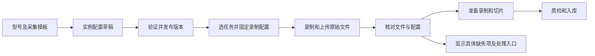

# 机器人实例采集与解析配置调整方案 待审核

**状态：待审核。版本：第一版。日期：2026 年 10 月 19 日。**

新机器人的状态、动作、相机通道和关节解释规则，应在实例创建或首次接入时完成配置，由后续录制和上传自动使用。上传页面展示本批次采用的配置、实际缺失的数据和处理结果，配置维护统一进入机器人实例。

本次交付为审核文档。下述页面改造、数据库迁移、采集端调整、服务发布和历史数据重试均为拟议工作，审核后由用户决定执行。

本方案补充现有的[机器人接入流程方案](robot-ingest-onboarding-proposal.md)和[机器人连接与选任务录制方案](robot-task-recording-proposal.md)。通过“数据源 → 机器人接入”创建的新设备仍复用同一个机器人实例；增加配置步骤不会产生第二套设备登记流程。

## 建议审核结论

建议采用以下规则。审核时可按编号提出修改意见。

| 编号 | 建议采用的规则 | 对使用流程的影响 |
| --- | --- | --- |
| A | 机器人实例统一维护采集与解析配置，型号模板提供初始值 | 新设备配置一次，同组织内切换项目和任务时复用 |
| B | 支持先登记实例并保存配置草稿，完成采集验证后才标记为可采集 | “实例已创建”“设备已连接”“采集配置已验证”分别展示 |
| C | 上传页面显示配置摘要和“前往机器人配置”，移除修改机器人默认配置的内嵌表单 | 操作员不再在某条失败记录里修改所有后续上传的规则 |
| D | 明确区分含 RGB 的采集方案和无相机的纯关节方案 | 缺少必需图像会阻止处理；经过确认的纯关节方案可以走完整处理流程 |
| E | 每次录制、每次处理固定配置版本；修改默认配置不自动改变历史记录 | 历史失败数据由用户明确选择配置并重试，已入库数据保留原结果 |
| F | 迁移现有配置时保留历史快照，遇到跨项目配置冲突时由管理员确认 | 不按最近更新时间直接覆盖，也不批量自动重跑旧数据 |
| G | 首版不在上传页面提供临时字段覆盖；配置变更需要机器人管理权限 | 配置来源、修改人和生效范围明确，上传重试仍使用上传处理权限 |

## 本次问题及已经确认的事实

问题数据来自机器人 **X1-001**、任务 **pick and place**。

| 项目 | 已确认事实 |
| --- | --- |
| 原始数据包 | `riu-445ff5ed97e8529db900a3af16cd0ff5` |
| 原始文件 | `teleop_20261019_154301.mcap`，937,362 字节 |
| 完整性 | 对象存储中的文件大小、SHA256 与上传清单一致 |
| 文件内容 | 25 个有消息的通道；包含关节、位姿、底盘命令等，没有图像消息 |
| 第一次处理 | 10 月 19 日 15:43，状态和动作映射为空，多个关节通道导致选择失败 |
| 配置记录 | 15:51 保存了状态 `/observation/joint_states`、动作 `/action/joint_states` |
| 后一次处理 | 16:25 使用上述映射，停止于 `MCAP_MAPPING_REQUIRED: select primary camera from []` |

以上时间为北京时间。保存时间可以从数据库确认；现有证据不能确认是谁、通过哪个入口完成了那次保存。

这次问题包含两个不同条件：一是平台需要明确关节通道的用途；二是上传文件实际没有图像。前置配置可以解决第一项，但不能给已有文件补出图像。采集端当前配置中存在头部 RGB 通道，也不能据此断定当时确实录到了图像。

同次录制的 LeRobot 版本已有一个 `READY`、质检 `PASS` 的 Episode。实施本方案时应保留该结果，重处理原 MCAP 前识别同源关系，避免把同一录制重复计为新增采集成果。完整关联标识见文末。

## 当前配置为何出现在上传页面

当前实例创建流程登记名称、序列号并绑定机器人模型，实例详情提供相机标定等信息，但没有连接 MCAP 解析配置。[实例创建与详情](../frontend/src/pages/p15-robots/instances-page.tsx)

MCAP 配置另存于 `ingest.mcap_robot_profiles`，键包含组织、项目、Region 和机器人。上传提交时处理器查这张表；没有配置则使用空配置，并尝试从文件自动识别。[配置存储](../backend/migrations/ingest/019_mcap_processing.sql) · [上传分发](../backend/src/hc_data_platform/robot_ingest/processing_dispatch.py)

上传失败记录中的“保存机器人解析配置”更新的是这份可复用配置，后续同范围上传也会受到影响。页面看起来属于一个数据包，实际修改范围却超出了这个包。[当前配置表单](../frontend/src/features/ingest/processing/components/McapPreparation.tsx) · [保存逻辑](../backend/src/hc_data_platform/lerobot_imports/mcap_processing.py)

当前无相机支持也不完整。工作区中的解析器已有“没有相机时使用状态时间轴”的改动，但后续录制配置仍要求至少一个相机，上传合同还要求视频资产。原文件临时验证停在相机数量校验。因此，单独取消主相机选择检查不足以完成修复。[MCAP 解析器](../backend/src/hc_data_platform/continuous_recordings/mcap_native.py) · [录制配置和资产合同](../backend/src/hc_data_platform/continuous_recordings/asset_models.py)

## 配置归属和职责

| 对象 | 负责保存什么 | 生效方式 |
| --- | --- | --- |
| 机器人型号及采集模板 | 对应型号、采集软件和格式的默认通道、关节解释规则 | 创建实例配置时引用一个明确的模板版本 |
| 机器人实例 | 该设备确认过的采集方案、实际通道映射、必需数据、验证状态 | 作为该设备后续采集的默认配置 |
| 相机标定 | 相机内参、外参及其适用版本 | 保留原有标定职责，与通道身份关联 |
| 采集任务 | 任务归属及任务自身的数据要求 | 不覆盖机器人通道；任务要求与实例能力不相容时明确阻止选择 |
| 一次录制和上传 | 实际配置版本、任务归属、文件清单和实际数据摘要 | 开始录制时固定，后续重试沿用 |
| 一次处理 | 解析配置快照、处理器版本和结果 | 可以复现该次解析，不随默认配置变化 |

型号模板必须与采集软件的输出协议匹配。仅绑定 URDF 模型不能推导出真实 ROS topic、动作来源或深度单位。无模板的新型号允许保存草稿，通过设备发现或样本文件生成候选值，再确认其含义。

实例配置按组织和机器人维护，不再要求为了切换项目重复填写一份相同配置。若同一设备确实使用多种采集软件或不同数据布局，可保存具名的采集方案，并为每种受支持格式设置明确的默认方案。多个方案无法唯一匹配时提示选择，不静默选最近修改的一项。

本轮优先补齐普通 ROS MCAP 的解析配置。已有 LeRobot、采集包及带标准内部结构的 MCAP 仍沿用各自合同，不强制它们填写 ROS 关节 topic；格式自带的字段也需要按其合同验证。

## 新机器人如何完成配置

### 创建和首次接入

从“机器人实例 → 新建实例”或“数据源 → 机器人接入 → 接入机器人”进入时，共用以下配置流程。

1. **登记设备。** 填写名称、真实序列号并选择型号；已有实例直接复用。
2. **确认采集方案。** 根据型号和采集软件带出模板，展示含 RGB 或纯关节等数据类型。没有模板时显示需要补充的字段。
3. **保存实例配置草稿。** 离线设备可以先完成登记，不把配置草稿标记为验证成功。
4. **连接并验证。** 设备连接后上报正在使用的配置摘要和通道信息；通过短样本确认所需通道有实际消息、类型和关节布局匹配。
5. **启用采集方案。** 验证通过后发布该配置版本，页面显示验证方式、时间和结果。
6. **选任务录制。** 机器人获取适用方案，检查任务要求与当前数据源，再开始录制。

“已连接”表示设备通信和认证有效；“采集配置已验证”表示指定版本的数据通道经过验证。两者不互相代替。采集配置尚未完成时，原始文件仍可按既有上传权限接收并保留，自动处理停在清楚标识的待配置状态；设备端可提供明确的“仅本地录制”。

历史样本验证只能证明该样本与配置匹配，页面应标为“样本验证通过”。在线录制前仍检查必需通道是否正在发布，不能用一份旧样本代替本次采集检查。

### 机器人实例中的配置页面

统一入口为 **机器人实例 → 选择设备 → 采集与解析配置**。“机器人接入”页面提供跳转入口并显示配置状态，不保存另一份独立配置。

建议页面展示以下信息：

```text
X1-001 · 采集与解析配置

采集方案       X1 ROS MCAP
配置版本       v2
配置状态       已验证
适用数据       含 RGB 的关节采集

状态通道       /observation/joint_states
动作通道       /action/joint_states
主 RGB 通道    /observation/cameras/head/color/compressed
关节布局       查看配置的关节顺序和单位
数据要求       RGB 必需，深度按方案声明

最近验证       时间、验证方式、实际消息数量、结果

[编辑配置]  [验证配置]  [查看版本记录]
```

上图表示目标页面，不代表当前 X1-001 已完成含图像验证。编辑时先“保存草稿”，通过验证后再“发布为默认”；页面明确新版本影响后续录制和处理，已冻结的历史作业保留原版本。

### 配置字段及校验

| 配置项 | 规则 |
| --- | --- |
| 适用格式和采集软件 | 声明该方案适用的格式、消息类型和采集协议，避免把一种格式的规则套给另一种格式 |
| 状态通道 | 确认实际反馈来源，必须存在有效消息；不能仅凭名称包含 `state` 判定角色 |
| 动作通道 | 确认实际下发目标或明确的动作来源，必须满足所选采集合同 |
| 关节顺序和单位 | 保存用于训练的明确关节布局；模型、状态和动作需匹配，缺少配置关节应报错 |
| RGB 相机 | 记录相机身份、topic、消息类型、必需或可选，并明确主相机 |
| 深度数据 | 声明是否需要、对应相机及单位换算；单位必须有配置或源元数据依据 |
| 采集类型 | 首版支持含 RGB 和无相机纯关节两类；含 RGB 类型的主相机为必需项 |
| 时间轴和同步 | 声明主时间来源和匹配容差，保留实际缺帧、间断和原始时间戳 |
| 验证记录 | 记录配置版本、验证样本或设备报告、时间及结果 |

自动发现只提供候选值。角色无法唯一确定时列出候选和缺失字段，不能把 `/action/joint_states` 因包含 `state` 而默认当作实际状态。

状态和动作的关节集合不同，也不能静默取交集后声称完成全部关节处理。管理员应确认训练使用的关节集合，额外原始通道保留在原文件中。当前 X1 文件的整机状态与动作关节数量不同，迁移时需要保留这一检查。

“使用下一帧状态作为动作”属于派生数据策略。首版不默认启用；确需使用时单独确认、明确标记来源，并满足对应任务的数据要求。

## 录制和上传如何使用配置



开始录制时固定机器人、采集方案、配置版本、配置摘要和任务归属。已有任务选择流程继续负责项目、数据集和 Region，解析配置不改变数据归属。

文件到达平台后仍需验证实际内容：配置填写了相机 topic，不代表包内存在图像；topic 被注册但消息数为零，也不能作为已采集图像的证据。结构、类型和模态缺失归入处理前检查，黑帧、重复帧等质量问题仍进入质检规则。

采集端上报与平台默认版本不一致时，显示版本差异。平台应识别已经固定且仍受支持的历史版本；未知版本或无法解释的布局变化保留原始数据并停止自动处理，不能悄悄按最新配置解释。

首版不由平台配置保存动作直接修改机器人运动控制、ROS 发布或相机驱动。采集端实际配置与平台声明不一致时，给出设备端需要调整的项目；采集参数同步属于另外的明确操作。

### 上传页面保留的操作

上传记录统一显示机器人名称、采集方案及版本、实际通道摘要、检查结果和具体错误。首页问题详情、采集任务记录、上传记录、数据集中的采集记录使用一致的信息和跳转。

| 操作 | 行为 |
| --- | --- |
| 查看解析配置 | 展示该批次实际采用的只读快照及其来源 |
| 前往机器人配置 | 定位到同一实例和采集方案，保留返回原数据包的入口 |
| 重试处理 | 展示准备使用的版本和与上次的差异；明确提交后创建新的处理记录 |
| 查看原始通道 | 显示实际 topic、消息类型、数量和时间范围，辅助定位缺失数据 |

移除上传记录内的“保存机器人解析配置”表单。保存实例配置不会自动重试所有失败记录，也不会自动把一批缺少 RGB 的数据切换成纯关节方案。

## 主 RGB 缺失和无相机数据如何区分

### 按采集方案判断

| 实例采集方案 | 文件实际内容 | 平台行为 |
| --- | --- | --- |
| 含 RGB，已指定主相机 | 指定通道有可解码图像 | 按既有含图像流程准备、切片和质检 |
| 含 RGB，已指定主相机 | 指定通道不存在或消息数为零 | 提示具体缺失通道，保留原始数据，停止自动处理 |
| 含 RGB | 存在多路 RGB，但配置未指定主相机 | 指向实例配置并列出候选，不选择任意一路 |
| 无相机纯关节 | 状态和动作满足配置，任务接受这种数据 | 使用声明的关节时间轴完成准备、切片和质检 |
| 无相机纯关节 | 任务明确需要图像 | 提示任务与采集方案不兼容，不能通过临时放宽相机要求继续 |
| 无有效配置或配置冲突 | 任意内容 | 提示待配置或配置冲突；不把缺省值当成已批准的纯关节方案 |
| 任一方案 | 声明为必需的深度通道缺失或单位无依据 | 指明缺失数据或单位依据，不能从 RGB 配置推断 |

首版不额外扩展“只有深度图像、没有 RGB”的录制方案；这类数据继续按其已有格式能力处理，不通过本轮纯关节方案兜底。

### 无相机支持必须覆盖完整流程

无相机模式需要具备明确的合同或版本标识，在以下环节共同实现，不能全局取消旧格式的图像约束：

- **录制配置和资产校验：** 允许该模式没有相机和视频资产，仍要求有效的配置、传感器数据及完整性信息；相应检查资产数量下限。
- **时间轴和对齐：** 使用关节状态时间来源，沿用明确的输出采样约定，保留原始时间与缺失证据；不压缩实际间断。
- **录制工作台和切片：** 提供关节曲线、时间范围及按时间切片入口；没有视频时不显示一直加载的视频播放器。
- **质检：** 执行关节维度、数值、时间、动作匹配等适用检查；图像检查显示“不适用”，整体质检结果仍由适用规则决定。
- **入库和导出：** 明确记录数据不含图像，不生成占位视频，也不声称满足需要视觉的训练合同。
- **版本兼容：** 读取旧含图像合同、旧采集包的行为保持明确，新模式的处理器版本与配置共同进入结果溯源。

纯关节流程完整通过验收后才向新录制开放。若分阶段上线，尚未具备处理能力时显示“该采集类型暂不支持处理”，保留已有数据，不展示虚假的成功状态。

### 错误信息建议

以下错误码为拟议细分名称，需在实施时统一后端、页面、接口文档和重试策略。历史错误码仍需兼容展示。

| 场景 | 建议错误码 | 用户看到的说明和入口 |
| --- | --- | --- |
| 实例没有可用解析配置 | `ROBOT_PROCESSING_CONFIG_REQUIRED` | 该机器人尚未完成采集配置，前往实例配置 |
| 状态或动作角色不明确 | `MCAP_MAPPING_REQUIRED` | 明确指出缺少状态或动作映射，并列出实际候选 |
| 配置通道不存在或类型不符 | `MCAP_MAPPING_INVALID` | 显示配置值、实际类型及文件中的通道信息 |
| 必需的 RGB 图像缺失 | `MCAP_REQUIRED_RGB_MISSING` | 未录入必需的 RGB 图像，显示预期 topic 和实际消息数 |
| 关节布局不匹配 | `MCAP_JOINT_LAYOUT_MISMATCH` | 显示缺少、增加或顺序不符的关节，前往实例配置或采集端检查 |
| 深度单位缺少依据 | `MCAP_DEPTH_UNITS_REQUIRED` | 补充深度单位来源，前往实例配置 |
| 多个历史配置无法确定 | `ROBOT_PROCESSING_CONFIG_CONFLICT` | 由机器人管理员确认适用方案，保留原始数据 |

本次 X1 若采用含 RGB 方案，应显示“文件中未录入必需的 RGB 图像”，并列出预期的头部相机通道。把主相机字段填成某个不存在的 topic，不能恢复这个包中的图像。

## 配置版本和权限

发布后的配置版本不可原地覆盖。修改时创建新草稿，记录修改人、时间、来源模板、变更内容和验证结果；并发修改通过版本校验提示冲突，避免覆盖他人的编辑。

默认版本只决定新的录制或尚未冻结的处理选择。已开始的录制、已排队上传及正在运行的处理继续使用其快照，不能在后台执行时再读取一个已经变化的默认值。

旧客户端没有携带版本时，首次接收按唯一匹配的有效实例方案固定快照；不能唯一匹配则保留数据并待确认。重试普通网络或服务故障沿用原版本；纠正映射或处理器逻辑时，用户明确选择修正后的版本并创建新的处理记录。

已有处理逻辑已把配置内容纳入处理标识，本轮在此基础上补充稳定版本、来源和审计，不删除历史处理快照。[当前处理身份与重试](../backend/src/hc_data_platform/lerobot_imports/mcap_processing.py)

配置管理使用组织内机器人管理权限。上传处理权限可查看本批次快照和提交重试，不自动获得修改组织级默认配置的权限。跨组织实例不可读取或修改；项目用户查看本批次配置时也不带出其他项目的数据。

## 现有数据和配置如何迁移

迁移前先生成清单，列出每台机器人在各项目和 Region 下的旧配置、差异、相关失败批次和已固定的处理快照。清单供执行者确认，迁移操作保持可重复运行且不重复创建版本。

| 现有情况 | 迁移规则 |
| --- | --- |
| 多个作用域的配置一致 | 合并为实例的一个历史来源版本，保留来源作用域和追溯关系 |
| 同一机器人存在不同配置 | 保留为候选方案并标记冲突；确认用途后选择默认或建立具名方案 |
| 只有旧配置，没有验证证据 | 标为待验证；保留旧作业和旧作用域的兼容读取，不伪造验证通过记录 |
| 没有任何配置 | 从适用模板生成草稿，仍需确认和验证 |
| 历史处理已经固定配置 | 保留原配置快照及版本关联，后续默认变更不改写历史 |
| 历史数据已入库 | 保留原 Episode 和质检结果，不自动生成重复成果 |
| 原文件缺少必需图像 | 保留原文件；需要视觉数据时补充有来源依据的同期数据或重新采集 |

兼容期间不得让旧上传表单继续无提示地修改另一套默认值。待迁移设备保留受控的旧配置读取；切换成功后，旧写接口返回明确的已迁移提示和实例配置入口，相关客户端同步升级。

针对本次 X1：迁移已保存的状态、动作映射作为历史来源配置，补充确认关节布局及采集类型。若业务要求图像，旧 MCAP 保持缺图像结论；若允许纯关节数据，在完整流程上线后由用户确认重处理，并先处理它与现有 LeRobot Episode 的同源关系。两种选择都不自动执行。

## 审核后的实施顺序

| 阶段 | 实施内容 | 完成条件 |
| --- | --- | --- |
| 一 | 实例配置模型、版本、权限和审计；旧配置盘点 | 能创建草稿、查看差异、发布版本并追溯来源；迁移冲突可见 |
| 二 | 实例详情和新设备接入流程接入同一配置；迁移确认过的配置 | 两个入口读写同一份配置，切换项目不要求重复填写 |
| 三 | 上传入口改为摘要和跳转；处理按版本使用配置；细化错误 | 所有失败入口能到达正确实例，页面不再隐式修改共享默认值 |
| 四 | 采集端配置摘要、开始录制前检查及版本固定 | 新录制携带明确版本，未知或冲突配置不会自动猜测；旧客户端行为明确 |
| 五 | 无相机合同、工作台、切片、质检、入库和导出适配 | 纯关节样本通过完整流程，含图像场景通过回归检查 |
| 六 | 试点启用，执行确认过的历史恢复 | 迁移计数一致，可追溯且无重复入库，错误信息与真实原因一致 |

平台实施范围涉及实例及接入页面、解析配置服务、上传分发、录制合同、工作台、质检和数据导出。机器人端改动接入 `HC-teleop-robotic` 的既有连接、录制及上传流程，与两份相关方案保持一致。

回退以关闭新配置写入口或暂停新模式分发为主，保留原始文件、新旧配置版本和处理记录。已采用新合同的作业由兼容该版本的处理器完成或暂停，不能退回旧处理器后按旧合同误解新数据。阶段一至三可以先交付；纯关节模式必须到阶段五验收后才开放使用。

## 验收标准

| 编号 | 场景 | 通过标准 |
| --- | --- | --- |
| 1 | 创建有模板的新机器人 | 自动带出模板版本，用户确认后保存到实例，上传页无需再次填写映射 |
| 2 | 从机器人接入创建或选择设备 | 与实例页面复用同一设备及配置，失败重试不重复创建 |
| 3 | 新型号无模板或设备离线 | 可保存草稿，明确待配置或待验证；不伪报在线验证成功 |
| 4 | 同一机器人跨项目采集 | 使用适用实例方案，任务归属仍正确；不存在作用域串用或跨组织读取 |
| 5 | 文件含多组关节 topic | 使用确认的状态和动作角色，无法唯一判断时列候选，不误选分臂或动作通道 |
| 6 | 状态与动作关节集合不同 | 按明确布局校验，缺少配置关节报错，不静默删减维度 |
| 7 | 含 RGB 方案缺图像或零帧 | 报具体缺失通道，原始上传保留，不生成可用 Episode |
| 8 | 图像存在但多相机未选主路 | 跳转实例配置并保留原数据，不随机选择 |
| 9 | 正常 RGB 和深度录制 | 原有准备、预览、切片、质检与入库通过回归；深度单位仍有依据 |
| 10 | 明确的纯关节方案 | 不要求视频资产，能按关节时间切片、质检、入库和导出，图像检查显示不适用 |
| 11 | 纯关节方案遇到需要视觉的任务 | 在适用性检查中明确阻止，不通过临时取消图像要求放行 |
| 12 | 发布新配置时旧录制仍在执行 | 旧作业继续使用原快照，新作业使用发布后的版本 |
| 13 | 修正映射后重试历史失败包 | 用户看到并选择配置版本，产生新的处理记录，旧记录可查 |
| 14 | 迁移同一机器人的冲突配置 | 无静默覆盖，默认选择明确，来源作用域和迁移结果可追溯 |
| 15 | 普通上传用户访问配置 | 可查看本批次信息和授权的重试操作，不能修改机器人默认配置 |
| 16 | 从首页、采集记录或上传记录处理问题 | 显示同一实际原因，能够跳转到正确实例和方案，再返回原数据包 |
| 17 | 同次录制同时存在 MCAP 和 LeRobot | 保留原有成功 Episode，同源恢复不重复计为新增采集或自动重复入库 |
| 18 | 旧格式和旧客户端继续上传 | 使用明确的兼容规则，不因缺少新字段损坏原始数据或改写已有结果 |

审核反馈可按 A 至 G 指定取舍，也可按验收编号补充要求。批准实施前需明确纯关节模式是否纳入本轮；若暂缓，它应保持明确的未支持状态，不能以跳过相机检查代替交付。

## 本次数据的恢复定位信息

以下标识仅用于审核后定位和恢复本次数据，不要求普通用户在页面手工输入。

| 对象 | 标识 |
| --- | --- |
| 机器人 | `robot_fa73724c028e571795e06eba838738fa` |
| 采集任务 | `286e7334-4f19-5d16-aecb-fb1d5870fed7` |
| MCAP 原始来源 | `raw-4909658c01345e0ab025fb0c0ec6d433` |
| 同次录制的 LeRobot 上传包 | `riu-6d4efe93d7b956129e04bd8441f5f954` |
| 已就绪且质检通过的 Episode | `rie-54102ae0b172579eafa375a28550c2b1` |

MCAP 原文件中没有图像消息的结论已核实；“当时相机未启动、订阅未收到、或使用其他采集配置”仍属于待查的采集端原因。本方案不把其中任何一种未经核实的原因写成既定故障。
