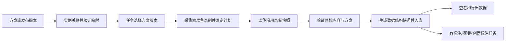

# 共享采集方案库与任务版本绑定实施计划

日期：2026 年 10 月 20 日。状态：供其他终端实施的计划，尚未实施本轮改造。

目标是把采集方案独立为组织内可复用的资产：机器人接入时创建或复用实例并关联方案；创建任务时选择已发布方案版本；采集端、上传、校验和入库使用同一份配置快照。一个实例支持多个方案，一个方案可供多个兼容实例使用。

实施入口为 **治理与资产 → 采集方案**。数据源中的机器人接入、机器人实例详情、采集任务创建提供关联、选择和前往新建的快捷入口。用户不需要为了创建任务重新填写关节、相机和解析规则，也不需要先配置业务标注规则才能接收和处理数据。

配套交接提示词见[执行提示词](shared-capture-schemes-execution-prompt-20261020.md)。

## 一 设计决定与范围

本计划采用共享方案库，替代“每台实例各自维护完整方案副本”的配置归属。已存在的实例映射、发布版本、处理快照和历史数据继续作为迁移来源与兼容依据。

| 决定 | 实施要求 |
| --- | --- |
| 方案独立存储 | 方案归属组织，拥有独立 ID、草稿、发布版本和归档状态，不把 `robot_id` 放进共享方案的身份 |
| 实例关联方案 | 实例保存可用方案关联、选择的版本、默认项及设备映射；关联已有方案不复制一份共享配置 |
| 任务固定方案版本 | 保存任务所选版本及参与实例的映射版本；修改实例默认项或发布新版不改变已固定的任务 |
| 上传记录完整来源 | 保存任务计划、方案版本、实例映射、解析后的有效配置和内容摘要；普通重试沿用原快照 |
| 同时支持实际使用的输入格式 | MCAP 和 LeRobot v3 都接入方案选择、版本校验和处理链路，不能只改 MCAP |
| 数据结构与业务标注分开 | 数据结构由采集方案与实际数据验证产生；标注规则决定后续标注，缺少标注规则不阻塞数据入库 |
| 保留真实数据 | 原始文件保持原样；不将 21 维数据盲目补成 29 维，不伪造图像，不把缺失数据当作真实零值 |
| 保持任务内结构一致 | 新任务约定一种输出结构；改变关节布局、必需相机或输出帧率时使用新的任务计划和新任务 |

本计划覆盖方案库、实例接入、任务配置、机器人端任务领取、上传处理、数据结构生成、标注解耦、迁移与验收。设备运动控制、自动修改相机驱动、跨组织公开方案市场、任意异构数据统一补零，以及没有现成实现的通用重采样算法不在本轮范围内。

方案里的采集要求用于约定和检查实际数据。平台选择了某个相机或频率，并不代表设备已经开始发布该数据。

## 二 当前问题及代码依据

### 已检查的数据差异

以下是本次会话在 2026 年 10 月 20 日的排查结果，实施时应重新读取当前状态，避免把旧失败状态当成实时结论。

| 数据 | 实例 | 输入格式与帧率 | 状态与动作 | 图像与底盘速度 |
| --- | --- | --- | --- | --- |
| 任务 14 较早成功数据 | X1-001 | LeRobot v3，15 Hz | 状态 29 维、动作 19 维 | 无图像，有 `action.base.velocity` |
| 任务 14 后上传的失败数据 | X1-001 | LeRobot v3，15 Hz | 状态 21 维、动作 19 维 | 有头部 RGB，无 `action.base.velocity` |
| 任务 16 的失败数据 | X1-001 | LeRobot v3，15 Hz | 状态 21 维、动作 19 维 | 有头部 RGB，无 `action.base.velocity` |

任务 14 后上传数据与任务 16 的 `meta/info.json` 一致。任务 14 自己也存在两种实际结构，不能将“任务 14”和“任务 16”直接当成两种结构的唯一标识。相同动作维度也不保证动作名称和顺序相同，迁移与匹配必须检查实际定义。

排查中，这两份新上传的文件大小、校验和及读取验证通过。任务 14 的新数据撞上该数据集已冻结的旧结构；任务 16 则因没有绑定标注 Schema，被准备流程阻塞。界面将不同原因归为 Raw 结构验证失败，掩盖了处理办法。

### 当前实现缺口

| 当前实现 | 影响 | 代码位置 |
| --- | --- | --- |
| 方案及发布版本以组织、机器人、方案为键 | 同一方案仍归属一个实例 | [方案表](../backend/migrations/ingest/024_robot_processing_configs.sql)、[方案服务](../backend/src/hc_data_platform/robot_processing/service.py) |
| 组织级模板存在，实例编辑器从模板复制配置 | 可作为迁移来源，但不是共享方案引用 | [模板接口](../backend/src/hc_data_platform/robot_processing/router.py)、[实例编辑器](../frontend/src/features/robots/ProcessingConfigEditor.tsx) |
| `Draft.source_format` 只接受 MCAP | LeRobot 未进入同一方案机制 | [方案模型](../backend/src/hc_data_platform/robot_processing/models.py) |
| 创建任务模型没有方案引用 | 新建任务无法确定本任务使用的结构 | [任务模型](../backend/src/hc_data_platform/collection_tasks/models.py) |
| 任务领取和上传主要在 MCAP 分支读取实例默认配置 | 任务选择不能稳定控制处理版本 | [连接与任务查询](../backend/src/hc_data_platform/robot_ingest/connections.py)、[上传会话](../backend/src/hc_data_platform/robot_ingest/service.py) |
| LeRobot 从标注绑定寻找数据结构目标 | 没有标注配置也会阻塞数据处理 | [规划查询](../backend/src/hc_data_platform/lerobot_imports/planning_queries.py)、[准备流程](../backend/src/hc_data_platform/lerobot_imports/pipeline.py) |
| 数据集结构只允许幂等冻结同一份合同 | 已有数据集不能直接接收另一套结构 | [结构注册](../backend/src/hc_data_platform/episode_store/schemas.py) |
| Collection 要求条目使用同一结构快照 | 不能通过吞掉结构冲突强行混入不同结构 | [Collection 模型](../backend/src/hc_data_platform/episode_store/models.py) |
| 工作流与成功回执要求标注任务 | 仅删除准备阶段的标注检查仍不足以完成解耦 | [工作流](../backend/src/hc_data_platform/workflow/temporal_workflows.py)、[处理回执](../backend/src/hc_data_platform/robot_ingest/lerobot_processor.py) |

旧客户端上报的 `config_fingerprint` 在已检查的不同结构间曾相同。新的匹配逻辑必须基于服务端核对的文件定义和实际内容，不能只依赖这个字段。

## 三 页面入口与用户流程

### 主入口

在现有 **治理与资产** 分组中增加 **采集方案**，与“机器人模型”“机器人实例”并列，建议顺序为机器人模型、采集方案、机器人实例。

建议列表路由为 `/settings/capture-schemes`，详情及编辑路由为该路径的子路由。页面 ID 按当前目录注册规则分配，不复用已经代表其他功能的页面 ID。

依据是方案属于跨任务、跨实例复用的组织资产。实际采集入口继续位于“采集与接收”，通过快捷入口使用方案库。[现有导航分组](../frontend/src/shared/routing/page-descriptor.ts)、[机器人模型路由](../frontend/src/pages/p14-robot-models/routes.tsx)、[机器人实例路由](../frontend/src/pages/p15-robots/routes.tsx)。

页面右上角提供“新建方案”。列表展示名称、适用型号或能力、输入格式、数据摘要、最新发布版本、使用实例数和任务数、状态。支持搜索、筛选、查看引用、编辑草稿、复制为新方案和归档。

详情默认展示数据摘要与使用情况，关节顺序、单位、话题映射等放在可展开的配置区域。界面使用“采集方案”“关节”“相机”“未采集”等业务名称，不要求用户理解数据库 Schema 或填写内部 ID。

### 新建与更新方案

新建可从空白、已发布方案或有权限读取的样本生成候选配置。按以下顺序完成：

1. 填写名称、说明、适用型号或能力、采集软件及支持的输入格式。
2. 确认状态、动作、相机、底盘等数据定义，分别确定关节名称、顺序和单位。
3. 选择必需或可选字段，确定时间轴与帧率策略。
4. 使用样本验证解析和数据合同，查看明确的差异后发布版本。

样本只提供候选定义，不能凭数量猜测关节含义、动作来源或单位。发布校验在组织方案层运行，不要求创建一台虚构实例来调用旧的实例配置接口。

验证结果关联草稿修订号、输入格式、解析器版本、样本摘要和内容哈希。草稿发生修改后，旧验证不再证明新草稿有效。一个方案若声明支持多个输入适配器，应逐个验证；没有实现或验证通过的格式不可标为可用。

发布后的内容不可原地修改。编辑产生新草稿，发布生成 v2、v3 等版本；页面显示哪些实例可以升级及其差异，已有任务保留使用版本。

### 接入机器人

在“数据源 → 机器人接入 → 接入机器人”中，创建或复用实例后增加“关联采集方案”步骤：

- 根据真实型号、采集软件和输入格式筛选兼容的已发布方案。
- 可以关联多个方案，并设置一个默认项。默认项只用于新建任务时预选。
- 保存设备特有的字段或话题映射，例如同一逻辑头部相机在不同设备上的实际 topic。
- 缺少合适方案时可先完成接入，显示“采集方案待配置”；保留表单状态，提供“前往新建方案”及返回路径。
- 重新提交或重试接入不重复创建实例、身份或方案关联。

共享方案的样本验证不等同于这台设备的在线验证。关联状态应区分“已关联”“映射待验证”“可用于采集”，不能因为共享版本发布成功就宣称所有关联设备已验证。

机器人实例详情中的原“采集与解析配置”区域调整为“采集方案”：列出关联及版本、默认项、映射状态，提供关联、升级、移除关联和前往方案库管理。移除关联不删除共享方案或历史快照。

### 创建任务

创建任务时选择参与实例，再从其兼容方案中选择一个已发布版本，展示数据摘要。实例只有一个可用方案时可预选，但仍显示名称和版本。

任务保存独立的采集计划。新任务在开始采集前必须有有效计划；旧任务进入兼容流程，不将缺少新字段误判为历史文件损坏。

当前任务系统允许不同实例贡献数据，不能通过新增选择框无意取消这一能力。单实例任务采用简洁选择器；多实例任务要求各参与实例关联同一所选方案版本，并分别具有有效映射，输出合同一致。后续新增参与实例必须经过同样的检查并保存明确的参与记录。

若任务指定已有数据集，创建或调整计划时就检查该数据集已冻结的结构与频率是否兼容。两个任务指向同一数据集时也遵守这一条件。

任务尚未开始时允许显式更换方案，生成新的任务计划修订。首次开始采集或创建上传会话时原子地固定计划；开始后，改变输出结构应创建新任务。列表 GET 请求不承担加锁或修改任务状态的副作用。

### 页面间跳转

数据源接入、实例详情、任务创建提供“选择方案”“查看方案”“新建方案”快捷入口，统一进入方案库，不维护第二套编辑器或配置副本。返回时保留原表单和范围上下文，并校验返回路径为站内合法地址。

只读用户可查看和选择其任务权限允许使用的已发布版本；共享编辑、发布和归档使用组织级管理权限。首版沿用并核对现有 `robot.read`、`robot.manage` 及任务管理授权，不以按钮隐藏代替服务端授权。

## 四 存储关系与版本规则

以下是逻辑实体；物理表名、迁移编号和模块路径按实施时的现有注册约定确定。

| 实体 | 身份与核心内容 | 可变性 |
| --- | --- | --- |
| 采集方案 | 组织、方案 ID、名称、说明、适用范围、最新发布版本、归档状态 | 元信息可修改，名称不作为身份 |
| 方案草稿 | 组织、方案 ID、修订号、完整配置 | 乐观并发控制，防止覆盖别人的修改 |
| 方案发布版本 | 组织、方案 ID、版本、配置文档、内容哈希、验证证据、发布信息 | 内容不可变 |
| 实例方案关联 | 组织、实例、方案、采用的版本、默认标记、关联状态 | 可显式升级或停用，保留变更记录 |
| 实例映射版本 | 关联 ID、映射版本、逻辑字段到设备来源的映射、验证证据和内容哈希 | 已被使用的版本不可变 |
| 任务采集计划 | 组织、项目、任务、方案版本、参与实例与映射版本、输出合同、计划修订及固定状态 | 使用后固定，不跟随实例默认值 |
| 录制与上传快照 | 任务计划引用、实例身份、方案和映射版本、实际有效配置、原始结构摘要、完整内容哈希 | 同一录制及普通重试保持不变 |

共享方案不保存设备序列号、认证凭据、单台设备地址等身份信息。实例映射负责来源名称等设备差异，不允许覆盖共享方案的关节语义、单位、必需项或输出结构；确需改变这些内容时创建新的方案版本或派生方案。

首版为每台实例设置一个默认方案关联。若它不支持当前选择的输入格式，页面要求明确选择其他方案，不按最近更新时间自动替换。默认项不会成为已配置任务的运行时后备来源。

共享方案、实例关联和数据集属于不同范围。组织内共享版本可在多个项目使用，但任务和数据读取仍保留现有项目与 Region 边界；引用的实例、版本和样本必须按实际授权校验。

归档方案不删除其已发布版本和历史引用。已归档方案不可用于新关联或新任务；已经固定的任务、在途上传和历史读取按原有有效快照完成。实例停用、凭据撤销等权限状态继续由原权限机制控制。

## 五 方案需要表达的数据合同

### 输入与输出

方案版本分开表达输入适配和输出数据定义：

- 输入格式、采集软件、解析器及受支持版本。
- MCAP 的消息类型、状态与动作来源、相机来源、时间来源和同步策略。
- LeRobot 的实际 feature 定义、dtype、shape、名称与顺序、图像定义及元数据约束。
- 输出状态与动作的语义字段、顺序、单位、相机角色、底盘等辅助信号。
- 必需与可选规则、缺失表示、质量规则引用、帧率策略。

使用有类型的格式配置，不能让 LeRobot 被迫填写不存在的 ROS topic。状态和动作可以有不同布局，分别验证。额外原始字段保留在 Raw 中；是否进入派生输出按已发布合同决定，不能悄悄修改合同。

结构摘要应覆盖影响解释的数据定义，包括字段名称、类型、维度、轴名称和顺序、单位、图像类型及尺寸、必要的时间定义。记录条数、上传时间等批次属性不参与结构身份。算法应有版本，且由服务端重新计算。

### 缺失与异常

必需字段不存在、存在但不可解析、维度或单位不符，应给出对应错误。可选字段未采集应保留缺失事实，查看器显示“未采集”。

统一逻辑合同中可声明可选字段，每批数据另存实际存在性；数值字段还需区分按帧或按轴的有效性。不得把“缺失”通过普通数值 0 冒充有效采集值，也不得把损坏文件归为正常缺失。

可选字段支持必须覆盖标准数据读写、查看器、质检和导出。目标导出格式若不能表达缺失，需要让用户选择满足要求的数据或兼容的字段集合，并明确显示不兼容原因；不得生成没有缺失标记的假数据。禁止只放宽入口校验、然后让包验证或导出再次失败。

### 帧率

首版默认保留原始帧率。对本次 X1 LeRobot 数据，应保持 15 Hz、原帧数及有效时间范围。

分别保存源帧率要求和输出策略。保留模式下，任务及数据集仍需固定一个具体频率；后续批次频率不一致时提示差异。可以在方案验证和任务建立时确定，不能对每批数据无声改变数据集频率。

已有受支持的转换策略可以显式选择并记录输入、输出频率及时间轴。尚未实现的转换选项不应显示为可用。不要沿用其他机器人或旧 MCAP 方案的 30 Hz 默认值来处理本次 15 Hz 数据。

## 六 从任务选择到入库的完整流程

1. **任务查询。** 按当前认证实例返回可参与任务及可选原因。MCAP、LeRobot 都返回任务方案和该实例映射，不从当前实例默认值覆盖任务选择。
2. **开始采集。** 通过明确的准备或启动操作，原子校验任务计划修订、设备映射、授权及兼容性并固定快照。若当前协议缺少该操作，应扩展协议；只读列表接口不做此写入。
3. **录制封存。** 本地录制元数据、封存包和上传队列保存同一方案引用及快照摘要。切换任务、发布新方案、刷新界面或重启服务不改变已封存录制。
4. **上传会话。** 服务端校验请求与认证实例、任务计划一致，保存服务端核实的有效快照。不能仅信任客户端传来的配置 JSON。已有会话的幂等恢复先使用原快照。
5. **结构验证。** 元数据预检用于尽早发现问题，完整处理仍验证校验和、实际列、维度、时间轴与媒体可解码性。元数据匹配不等同于全部文件有效。
6. **数据处理。** 使用所选输入适配器生成标准结果、实际存在性及质量报告。普通重试使用原配置；采用修正后的配置重处理需要形成新的处理尝试和版本记录。
7. **发布结果。** 数据提交成功且满足现有质检和可读性规则后显示处理结果；标注状态独立呈现。

无配置或配置不匹配时，按照既有上传权限保留已接收的 Raw，停止自动解析并显示待配置或不匹配原因。配置问题不得伪装成文件损坏，也不得作为瞬时技术失败持续自动重试。

客户端未携带新方案引用时，只能走明确的历史兼容路径。服务端能从该任务唯一固定的计划得出版本时可使用它并注明来源；有歧义或无法解释时停在待配置，不能回退到“当前默认方案”碰运气。

## 七 数据结构与标注解耦

### 数据结构生成

数据结构快照由任务约定的输出合同及实际数据验证确定，不能继续从业务标签绑定取得其身份。

共享方案 ID、方案版本、实际输入结构摘要、数据集结构快照 ID 分别保存。相同输出合同的不同方案版本可以复用数据集已冻结的结构；仅质量策略变化不应人为制造结构冲突。

数据集结构快照仍属于具体组织、项目、Region 和数据集。采用确定性的结构身份与幂等创建，结构指纹包含当前粗粒度 `topic → json` 表达未覆盖的关键语义，例如轴顺序和单位。若扩展现有指纹算法，必须保留历史算法版本和读取兼容，不能重新计算后宣称旧成果无效。

保留 `episode_store.dataset_schemas` 和 Collection 的一致性约束。新任务应在首批正式写入前验证输出合同；不同结构不通过删除旧结构行、覆盖结构文档、忽略 `PackageConflict` 或放宽 Collection 校验混在一起。

一个数据集中存在可选字段的批次差异时，固定逻辑合同与每批存在性分别处理。导出仍按具体格式校验实际可消费的数据，不能只因为逻辑合同一致就宣称可直接合并训练。

### 标注流程

删除 LeRobot 准备阶段对“唯一业务标注绑定”的前置依赖，改为从任务采集计划取得数据合同；业务标签仍在现有标注模块配置。

同时调整工作流、活动输入、成功结果与机器人端回执：

- 未配置标注规则时，合格数据可以完成入库、查看和 Raw 或标准数据导出；标注状态显示“未配置”或“待配置”。
- 已配置规则时，仍按现有机制创建标注任务，并保留关联。
- 数据已经提交后，标注创建失败单独记录、单独重试，不重新提交同一个 Episode，也不把已可读数据伪装成 Raw 损坏。
- 数据可读、质量结果、标注完成和训练可用分别判断；没有标注不等于已完成需要标注的训练交付。

检查所有相关工作流分支，而不只改一个条件。Temporal 工作流改动需要兼容已有运行历史，使用项目现有版本或 patch 机制并执行相应回放或兼容测试。

## 八 接口与代码改动位置

### 接口合同

建议增加组织级共享方案接口，语义包括列表、读取版本、保存草稿、验证、发布、查看引用和归档。实例接口维护关联与映射版本；任务接口保存计划及参与实例；机器人端取得任务的有效配置并在录制准备时固定。

可采用 `/api/v1/organizations/{organization_id}/capture-schemes` 作为共享资源前缀。其他路径沿用现有资源路由习惯。名称属于拟议合同，落地时同步 OpenAPI、生成类型、鉴权清单和客户端，不手改生成物来掩盖合同不一致。

写入采用乐观修订或幂等键；发布、变更默认项、开始录制与任务换方案要处理并发。共享版本内容、实例映射和任务计划的摘要必须有明确含义，不混用一个“配置指纹”。

### 实施定位

| 范围 | 主要位置与改动 |
| --- | --- |
| 共享配置模型 | `backend/src/hc_data_platform/robot_processing/`；拆出组织级方案服务，复用有效的解析校验逻辑 |
| 数据库迁移 | `backend/migrations/ingest/`、任务相关迁移、manifest；采用新增迁移，不修改已应用迁移内容 |
| 实例接入 | `robot_ingest/onboarding_models.py`、`onboarding_repository.py` 与实例资产服务；同一接入事务或可幂等恢复流程中保存关联 |
| 任务创建与计划 | `collection_tasks/models.py`、服务、repository、任务 OpenAPI 与创建表单 |
| 任务领取与上传 | `robot_ingest/connections.py`、`service.py`、`processing_dispatch.py`、`processing_store.py`、`lerobot_processor.py` |
| LeRobot 解析与规划 | `lerobot_imports/planning_queries.py`、`pipeline.py`、reader 与 package；校验方案并移除标注前置依赖 |
| MCAP 解析与处理 | `continuous_recordings/mcap_native.py`、相关 processing 及 `lerobot_imports/mcap_processing.py`；读取固定配置 |
| 数据结构与导出 | `ingest/schema_planning.py`、`episode_store/schemas.py`、模型、读写验证及 `collection_export.py` |
| 工作流与回执 | `workflow/temporal_workflows.py`、`activities.py`、相关模型和机器人处理回执 |
| 前端入口与编辑 | 页面 `routes.tsx`、导航注册、`ProcessingConfigEditor.tsx`、实例详情、接入对话框、任务页面 |
| 错误和状态 | dashboard、quality、上传处理记录及查看器；统一语义，保留已修复的删除和重复数据过滤 |
| 机器人端 | `/home/hc_op/workspace/teleop_ws/src/HC-teleop-robotic` 下的 `middleware/core/platform_api.py`、`platform_connection.py`、`task_recording.py`、`recording_artifacts.py` 及 `upload_client/` |

平台实际目录为 `/home/hc_op/workspace/hc_DataPlatform`。不要把旧文档中的 `/home/hc_op/workspace/HC-teleop-robotic` 当作当前机器人源码位置；本次读取确认源码位于上表的 `teleop_ws/src` 下。

## 九 错误与处理入口

以下为需要表达的错误语义，最终错误码按现有命名规范注册。使用结构化的期望值、实际值和字段路径，避免所有异常落到 `LEROBOT_SOURCE_INVALID`。

| 情况 | 界面表达 | 处理方式 |
| --- | --- | --- |
| 任务尚未选择方案 | 任务采集方案待配置 | 前往该任务配置，Raw 保留 |
| 实例未关联或映射不可用 | 当前机器人不能使用此任务方案 | 前往实例关联或修复映射 |
| 版本未知或内容摘要不一致 | 采集方案版本不匹配 | 展示任务与录制版本，保留原数据 |
| 输入格式没有适配器 | 方案不支持当前上传格式 | 选择兼容方案或适配器 |
| 关节名称、顺序、单位或维度不同 | 实际数据与方案不一致 | 明确字段及差异，停止自动处理 |
| 必需相机没有有效数据 | 缺少方案要求的相机数据 | 显示相机角色和实际来源 |
| 可选字段没有采集 | 未采集 | 正常按缺失规则处理 |
| 文件损坏、列内容非法或媒体解码失败 | 原始数据内容无效 | 保留具体文件与验证原因 |
| 已有数据集结构不兼容 | 任务数据结构与已有数据集不兼容 | 使用相容任务，或进入明确的历史归属处理 |
| 没有标注规则 | 标注待配置 | 入库不因此失败，提供标注入口 |

工作台信号轨道不增加“历史处理”文字。已删除数据和已确认重复数据不再成为当前失败、阻塞或待处理问题；该生命周期过滤应继续覆盖新错误类型。历史审计可在具体记录中查询，但不重新抬升为当前问题。

## 十 迁移与已有任务处理

### 旧方案和旧客户端

先生成只读盘点：实例方案及版本、组织模板、默认项、任务引用、上传快照、真实结构摘要、在途任务和历史成功成果。将“可直接迁移”“需要补充映射”“结构混合或证据不足”分开列出。

旧方案可以按完整语义归一化后的内容摘要提出共享候选，不能按方案名称、状态维度、客户端指纹或最近修改时间合并。归一化时仅剥离设备身份与明确属于映射的来源差异，保留单位、字段语义、布局、处理器与策略差异。

迁移采用新增共享实体、旧到新引用映射和兼容读取，保留旧发布版本、原始内容哈希、审计、处理快照及源文件。相同迁移清单重复执行必须幂等，不把迁移创建时间伪装成原发布或验证时间。

历史任务没有新计划时，仅在已用数据和快照能唯一确定含义时建立兼容映射；证据不足则标明待配置。已有成功数据继续读取，不因缺少新字段被降级。

### 任务 14 与 16

任务 16 的样本与任务 14 后上传样本属于同一已观察结构，可作为“关节与视觉”方案的候选样本。候选名称不代表已经发布或绑定。方案需要保留完整 feature 定义，不能只填写“21 维、19 维、有图像”。

任务 16 在关联正确的数据合同并解除标注前置阻塞后，可按正常幂等处理流程恢复。执行前检查当前状态，避免重处理已经成功的数据。

任务 14 较早成功数据与后上传数据结构不同。禁止给任务 14 整体套上新方案，或覆盖其数据集已冻结结构。默认恢复建议是保留旧结构及成功成果，为新结构使用单独的新任务；若业务决定将新结构数据归到其他兼容任务，必须通过有来源记录的正式归属修正或重新导入流程。

本次代码实施交付应先形成真实历史数据的 dry-run 清单，包含每条 Raw 的当前归属、结构摘要、候选方案、计划动作、成功成果保护和重复判定。历史归属修改、真实重试或重新导入按执行终端收到的用户授权执行；不以直接改数据库绕过幂等和审计来制造成功状态。

### 上线与回退

1. 在隔离环境安装新增表和兼容服务，验证旧数据仍可读取。
2. 运行迁移盘点并核对冲突，验证同一清单重复执行不产生重复方案或关联。
3. 发布支持新协议的服务与客户端，再启用新建任务的方案要求；旧客户端走显式兼容流程。
4. 验证在途上传和 Temporal 历史兼容后，按现有发布机制启用入口。
5. 回退时停止新方案的使用入口，保留新表、不可变版本和快照，由兼容处理器完成在途工作；不删除新数据或恢复整库覆盖后续业务。

具体部署范围服从执行终端已有授权。迁移、备份与发布使用项目现有流程，不另写绕过 migration manifest 的手动 SQL。

## 十一 实施步骤

| 阶段 | 工作 | 完成条件 |
| --- | --- | --- |
| A 当前基线 | 读取适用指引，盘点平台和机器人源码、未提交改动、已运行服务及当前真实数据 | 有可核对的基线与隔离工作区 |
| B 合同与存储 | 建立共享方案、版本、实例关联、映射版本、任务计划和快照合同及迁移 | 模型、并发、范围校验、幂等迁移测试通过 |
| C 方案与接入界面 | 增加方案库入口和编辑发布流程，接入与实例详情改为关联共享方案 | 可以从方案创建走到实例关联，返回路径与权限正确 |
| D 任务与采集端 | 创建任务选方案，启动时固定计划，客户端封存和上传携带同一引用 | 换任务、换默认项、升级方案及重启不串配置 |
| E 处理与数据结构 | MCAP 和 LeRobot 读取任务计划，验证实际结构，生成独立数据合同 | 同实例不同任务正确入库，不再依赖业务标签建立结构 |
| F 标注与状态 | 修改工作流、成功回执、导出和错误分类，保持删除与重复过滤 | 没有标注也能完成符合条件的入库，错误可定位 |
| G 迁移与验收 | 完成兼容测试、真实结构复现、浏览器流程和迁移清单 | 交付证据、已知问题、发布和回退步骤 |

本轮有多个终端共同使用工作区。当前平台存在大量既有未提交修改，开发服务会读取运行目录并热加载。实施应在隔离 worktree 或副本完成，带入本计划依赖的既有改动；仅从干净 HEAD 新建 worktree 会漏掉已经存在的实例方案、接入、删除和错误生命周期修复。

记录开始时的差异及必要文件摘要，合入前复核其他终端新增修改。不得 reset、clean 或覆盖无关变更。不要将共享开发服务意外热加载的半成品当作受控发布。

## 十二 验收矩阵

以下验收使用隔离数据和代表性结构，真实数据只读核对或按明确授权处理。

| 编号 | 场景 | 必须得到的结果 |
| --- | --- | --- |
| 1 | 两台兼容实例关联同一已发布方案 | 共享同一方案版本，无重复配置副本，各自映射独立 |
| 2 | 同一实例关联纯关节与视觉方案 | 两个任务分别选方案，正确生成不同但各自一致的数据集 |
| 3 | 接入时暂未配置方案 | 实例接入成功，显示待配置，配置完成后可参与任务 |
| 4 | 接入重试或发布响应丢失 | 幂等恢复，不重复建实例、关联或版本 |
| 5 | 不兼容型号、字段语义或格式 | 任务选择或启动前给出具体原因，服务端也拒绝越过检查 |
| 6 | 一个任务有多台实例参与 | 使用同一版本及兼容输出，各实例映射随录制固定 |
| 7 | 发布 v2 或修改实例默认项 | 已固定的 v1 任务、录制和在途上传继续使用 v1 |
| 8 | 开始录制与更换任务计划并发 | 只接受一致的修订与快照，明确返回冲突 |
| 9 | 录制后切任务、重启或重试上传 | 原录制保留原任务、版本和归属 |
| 10 | MCAP 纯关节和带图像样本 | 均按声明的时间来源、关节映射与相机规则处理 |
| 11 | LeRobot 29 维无图像与 21 维有图像样本 | 不使用 MCAP 默认规则，各自在匹配任务中处理成功 |
| 12 | 维度相同但轴名称、顺序、单位或来源有效性结构不同 | 服务端识别差异，不只比较长度或客户端指纹 |
| 13 | 必需相机缺失与可选相机未采集 | 前者显示具体阻塞；后者可按合同读取和处理，不生成假视频 |
| 14 | 可选数值缺失与真实零值 | 保留可区分的存在性或有效性，质检和导出遵循同一语义 |
| 15 | 原始样本为 15 Hz | 保留原频率和帧数，不显示固定的 30 Hz 错误，不发生 167 帧变 168 帧的时间精度回归 |
| 16 | 无业务标注绑定的新任务 | 合格数据入库且可查看，标注状态独立；不创建虚假业务标签 |
| 17 | 数据提交后标注创建失败 | 数据仍可读，标注可单独重试，不重复提交 Episode |
| 18 | 老 Temporal 历史与旧回执 | 兼容读取或回放，新旧执行路径不破坏幂等 |
| 19 | 目标数据集已冻结另一结构 | 在写入前明确报不兼容，不覆盖旧 schema 或绕过 Collection 校验 |
| 20 | 已删除或已确认重复的数据 | 当前工作台不显示残留失败，新代码不恢复旧问题；无“历史处理”文案 |
| 21 | 跨组织引用版本、实例或验证样本 | 服务端按范围与权限拒绝，不泄露样本或设备信息 |
| 22 | 方案归档或实例移除关联 | 禁止不合规的新使用，历史读取及合法在途任务仍按快照运行 |
| 23 | 旧方案迁移执行两次 | 新对象与映射不重复，旧快照、成功成果及审计保持原义 |
| 24 | 从接入和任务表单前往新建方案再返回 | 表单和上下文保留，方案选择可用，不重复创建实体 |
| 25 | 标准数据与导出 | 匹配结构可查看及导出；不支持的缺失组合有明确处理入口，不能默默补假值 |

后端执行与变更相关的服务、真实数据库集成及工作流测试，覆盖 `robot_processing`、`robot_ingest`、`collection_tasks`、`lerobot_imports`、`episode_store`、`workflow`、dashboard 和 quality 的受影响路径。运行 Ruff、相关类型检查、迁移检查和 OpenAPI 一致性检查。

前端运行相关 Vitest 测试、`pnpm typecheck`、`pnpm check:architecture`、API 生成与检查及构建。浏览器验证实际入口、表单、返回路径、版本展示和错误定位。机器人端运行任务录制、封存、上传交接及平台合同测试；无需为验证配置执行真实机器人运动。

复用现有测试命令和环境，记录每项命令、结果及必要日志。既有失败与本轮新增失败分别说明；未执行的测试不能写为通过。纯文档交接阶段不需要运行上述业务测试。

## 十三 交付内容

- 平台和必要机器人端的实现、迁移、OpenAPI 与生成类型，附变更说明。
- 方案库、实例关联、任务选择和上传结果的浏览器验证证据。
- 验收矩阵及测试结果，说明数据可读、标注与训练交付的不同状态。
- 旧方案迁移 dry-run 清单和 14、16 的结构盘点与恢复建议。
- 发布、在途工作兼容和回退步骤；明确哪些真实数据操作已经执行。

不以“页面可以创建方案”作为完成标准。任务选择必须真正决定采集、上传和处理使用的配置，LeRobot 和 MCAP 都应走通。

## 附录 排查对象与背景文档

范围为组织 `01`、项目 `01`、Region `global`。下面的 ID 仅用于只读定位及生成具体迁移清单，不是修改真实数据的脚本。

| 对象 | 标识 |
| --- | --- |
| X1-001 实例 | `robot_fa73724c028e571795e06eba838738fa` |
| 任务 14 | `286e7334-4f19-5d16-aecb-fb1d5870fed7` |
| 任务 14 数据集 | `dataset_task_eb015818ce07a378b4594ea7db3b245f` |
| 任务 14 较早成功 Raw | `raw-c3f2e3f513795be5a0a3d5a47c8ddafe` |
| 任务 14 后续成功 Raw | `raw-53fb2d862a3a5266b55294c5f387d64b` |
| 任务 14 新结构 Raw | `raw-04405f9a9c555600be2939786d84c303` |
| 任务 14 已删除 MCAP Raw | `raw-6bda50f9801957bbb69ef48db6fe9a67` |
| 任务 14 已确认同源重复 MCAP Raw | `raw-4909658c01345e0ab025fb0c0ec6d433` |
| 任务 16 | `3dc3e389-c307-583a-99d5-1cd2cec8d98d` |
| 任务 16 数据集 | `dataset_task_822e0035cf6e81b24e82ce98941b72a8` |
| 任务 16 Raw | `raw-11a7f1690a3d5bc5aa3e46193d4e1fd9` |

背景资料为[实例配置旧方案](robot-instance-processing-config-proposal.md)、[已有实施记录](robot-instance-processing-config-implementation.md)、[机器人接入方案](robot-ingest-onboarding-proposal.md)、[机器人选任务录制方案](robot-task-recording-proposal.md)。

本计划替代旧方案中“完整配置统一归实例维护”“LeRobot 不接入本轮方案机制”等与本轮决定冲突的部分。旧文档的阶段状态用于理解历史，不应被重新解释为本轮需要用户重复确认每个常规实现步骤。真实操作范围以执行终端的当前用户指令为准。
